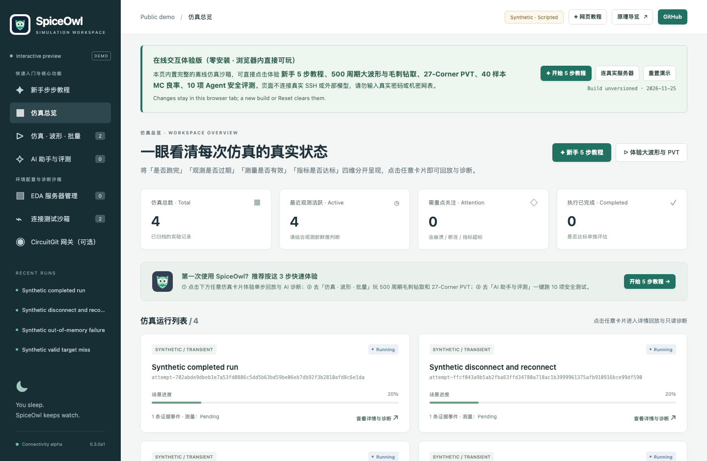
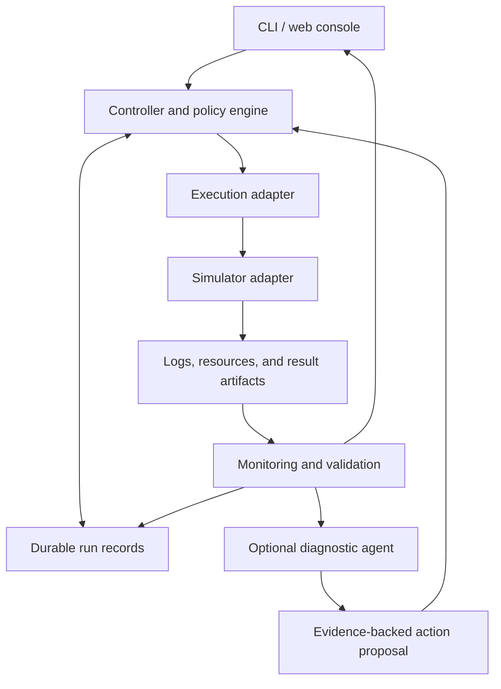

<p align="center">
  
</p>

<h1 align="center">SpiceOwl</h1>

<p align="center"><strong>You sleep. SpiceOwl keeps watch.</strong></p>
<p align="center">An open-source agent console for long-running circuit simulations.</p>
<p align="center">English · <a href="README.zh-CN.md">简体中文</a> · <a href="docs/architecture.md">Architecture</a> · <a href="docs/roadmap.md">Roadmap</a> · <a href="CONTRIBUTING.md">Contributing</a></p>

<p align="center"><a href="https://joshuazeng713.github.io/spiceowl/"><strong>Open the interactive demo</strong></a> · <a href="https://github.com/joshuazeng713/spiceowl/tree/main">Current alpha source</a></p>

> **Try it in your browser — no installation.** Explore original synthetic runs, connection states and scripted diagnoses. SSH, real agents and simulation execution require a local installation. The public demo currently follows `main`; the [publishing guide](https://github.com/joshuazeng713/spiceowl/blob/main/docs/github-pages.md) explains automatic updates.

> **Early alpha — server pool, native agent Q&A and a developer inverter smoke test.** Compare bounded SSH resource observations, prepare standalone or Virtuoso-origin execution plans, and ask an installed Codex runtime a short question. Web-console runs and run diagnoses remain synthetic. A separate, opt-in [developer script](examples/inverter/README.md) can execute the original MOS1 inverter on a licensed Spectre installation; general web/CLI job submission and unattended monitoring remain planned. Optional MCP tools read saved records. See the [console guide](docs/local-console.md), [server pool guide](docs/server-pool.md), and [native Q&A guide](docs/native-agent.md).



*Actual prototype interface with authored synthetic observations.*

## Why SpiceOwl

You start a simulation before leaving the lab. In the morning, the connection is gone, a job ran out of memory, or the run finished without the signals needed for your measurement.

SpiceOwl is being built to turn that uncertainty into a clear record: what ran, what happened, which recovery actions were taken, and whether the resulting data answers the intended experiment.

Our first target is **analog and mixed-signal research using Virtuoso and Spectre**, beginning with one validated Linux execution environment. Public development will use synthetic fixtures and a mock executor so contributors can participate without a commercial simulator or PDK.

## What we are building

| Capability | Intended behavior | Status |
| --- | --- | --- |
| Connect | Manage user-owned agent runtimes and model APIs with explicit auth, capability, and usage boundaries | Native Codex Q&A, fake agent/API management, MCP queries and SSH host/resource checks implemented |
| Observe | Track execution identity, simulation progress, logs, memory, and disk usage | Real host snapshots and developer smoke receipts; web runs remain synthetic |
| Reconnect | Reconcile an existing job after a client or controller interruption | Local record recovery and same-run smoke status queries; general simulator reconnection planned |
| Validate | Check inputs, required signals, measurement windows, and result completeness | Acceptance reducer and dedicated inverter waveform checks; general waveform validators planned |
| Recover | Apply bounded, recorded recovery policies for supported failures | Advisory policy only; dispatch disabled |
| Diagnose | Use an optional agent to explain evidence and propose actions | Offline fixture diagnosis implemented |
| Report | Separate execution outcome, measurement validity, and circuit performance | Synthetic web reports and a separate inverter smoke report |

### A morning report should answer three different questions

| Question | Example answer |
| --- | --- |
| Did the simulator finish? | Execution completed |
| Is this a valid measurement of the requested experiment? | Inputs matched; required signals and time window are present |
| Did the circuit meet its specification? | No — settling time exceeded the target |

A valid result that misses a design target is still a result worth preserving. Recovery must not change the experiment simply to turn a failure into a pass.

The report also shows observation freshness separately, so an old running status is not mistaken for a current observation.

## Design principles

- **Execution survives the interface.** A remote execution service or scheduler owns the job; the browser and agent conversation do not.
- **Unknown is a real state.** A missing connection is not proof of a failed simulation. Reconcile the original job before considering another submission.
- **Rules keep watch; agents investigate.** Routine monitoring and known recovery policies should work without an LLM. An agent proposes structured actions that the policy layer evaluates.
- **Every attempt has provenance.** Preserve the resolved inputs, tool identity, execution receipt, evidence, and changes between attempts.
- **Recovery preserves experimental intent.** Changes to tolerances, stimuli, corners, seeds, or measurement definitions require an explicit policy or a reviewed new experiment.
- **Resume means what the backend supports.** Controller recovery, job reconnection, and solver checkpoint recovery are separate capabilities.

## Planned architecture



The [architecture](docs/architecture.md) defines ownership and failure handling. The [run contract](docs/run-contract.md) defines what must be recorded before an experiment can be trusted.

The current slice adds **a server pool, execution-origin planning and native Q&A**, following the [P0.3 contract](docs/contracts/p03-pool-agent.md). The earlier [P0.2 contract](docs/contracts/p02-connectivity.md) covers SSH/MCP fundamentals. The broader [implementation plan](docs/design/integration-plan.md) also proposes API-key and ACP routes; these remain future work. The [three design workstreams](docs/design/README.md) share the [interface boundaries](docs/contracts/interface-boundaries.md).

## Repository map

```text
spiceowl/
├── README.md                  # English introduction
├── README.zh-CN.md            # Chinese introduction
├── docs/                      # Architecture, run contract, roadmap, decisions
├── assets/brand/              # Editable project icon and exported avatar
├── examples/                  # Original inverter and draft configuration examples
├── scripts/                   # Opt-in developer inverter smoke and result utilities
├── src/spiceowl/              # Installable Python package
│   ├── domain/                # Experiment, attempt, receipt, and event models
│   ├── adapters/              # Execution and simulator integrations
│   ├── monitoring/            # Observation and failure classification
│   ├── validation/            # Input and measurement acceptance checks
│   ├── recovery/              # Policy evaluation and action proposals
│   ├── storage/               # Durable records and artifact references
│   ├── agent/                 # Connections, sessions and optional diagnosis
│   ├── mcp/                   # Optional read-only tools for existing agents
│   ├── scheduling/            # Resource placement and simulation-origin plans
│   ├── cli/                   # Local command interface
│   └── web/                   # Loopback API and bundled browser assets
└── tests/                     # Offline tests and synthetic fixtures
```

The package includes fake AI connections, a SQLite controller, synthetic replay, acceptance/policy helpers, private host profiles, bounded SSH probes, optional MCP queries, CLI and bundled web assets. The [local console guide](docs/local-console.md) distinguishes these implementations from later job monitoring. The [foundation decision](docs/decisions/0001-project-foundation.md) records the original design choices.

## Start here

With Python 3.11+ on macOS or Linux:

```bash
git clone https://github.com/joshuazeng713/spiceowl.git
cd spiceowl
python3 -m venv .venv
.venv/bin/python -m pip install .
.venv/bin/spiceowl serve --demo
```

Open the printed loopback URL. Explore Connections, inspect a synthetic run, advance its observations and request a demo diagnosis. No model, simulator, Node.js or credentials are needed. Repeating `--demo` preserves stored history. The [guide](docs/local-console.md) covers CLI commands, persistence, limitations and tests.

To add a real connection, use **Simulation hosts → Add host**, or import an operator-authored host profile using `spiceowl hosts add --file PROFILE.json`. Registration saves local configuration; **Check connection** explicitly verifies the selected host. OpenSSH uses your existing alias and jump-host configuration. The [host onboarding guide](docs/host-onboarding.md) explains setup, safe retries and separate trust, authentication, network and stale-resource states. Version queries do not establish license availability, job state, or simulation validity.

To expose stored observations to Codex or another MCP client, install `.[mcp]` and configure the client to run `spiceowl --data-dir ABSOLUTE_STATE_DIR mcp`. This optional server uses the official Python MCP SDK and reads the same local database without owning the controller. It cannot launch simulations or query arbitrary paths. Follow the [real connection guide](docs/real-connections.md) for the profile schema, commands and verification boundaries.

For multiple nodes, use **Simulation hosts → Import pool** to preview an explicit hostname list and register it using an existing route template, or use `hosts import-pool`. Select up to 32 rows and use **Check selected hosts**; the CLI offers `hosts scan --hosts HOST_ID ...`. The browser evaluates requested CPUs and memory within the same selected batch. Unknown or stale nodes are excluded. Placement retains a resource margin and is a proposal, not a reservation. Standalone plans select a candidate for a new exported netlist; Virtuoso-managed plans preserve the original host/native run mapping.

For real text answers, register a private native runtime profile using `agents add --file PROFILE.json`, then open **Agent chat**. This uses the runtime's existing provider/auth configuration, which may be a subscription or a separately configured API route. Requests have durable keys, no automatic provider fallback, and no simulator tools. See the [native Q&A guide](docs/native-agent.md).

## Developer inverter smoke test

The source-checkout utility [run_inverter_smoke.py](scripts/run_inverter_smoke.py) provides an explicit `prepare → stage → launch → status → collect` workflow for the [original toy MOS1 inverter](examples/inverter/README.md). It requires a registered, authorized Linux host with licensed Spectre, GNU `timeout`, and a working Python 3.6+ interpreter. Replace `HOST_ID` with a registered host ID and `PYTHON_ABSOLUTE_PATH` with that remote interpreter's absolute path. Run the steps individually and inspect each result before continuing:

```bash
PYTHONPATH=src .venv/bin/python scripts/run_inverter_smoke.py prepare --data-dir .spiceowl --hosts HOST_ID --run-key inverter-smoke-001 --remote-python PYTHON_ABSOLUTE_PATH
PYTHONPATH=src .venv/bin/python scripts/run_inverter_smoke.py stage --run-dir .spiceowl/smoke/inverter-smoke-001
PYTHONPATH=src .venv/bin/python scripts/run_inverter_smoke.py launch --run-dir .spiceowl/smoke/inverter-smoke-001
PYTHONPATH=src .venv/bin/python scripts/run_inverter_smoke.py status --run-dir .spiceowl/smoke/inverter-smoke-001
PYTHONPATH=src .venv/bin/python scripts/run_inverter_smoke.py collect --run-dir .spiceowl/smoke/inverter-smoke-001
```

If the remote launch environment needs explicit license configuration, append the optional `--license-env-json PRIVATE_LICENSE_JSON_PATH` to **prepare**. The private JSON object accepts only `CDS_LIC_FILE` and/or `LM_LICENSE_FILE`; their values are frozen in the private plan and passed to the solver environment. Omit the option when the existing environment is already configured. A successful version check does not prove that a simulation license is available. See the [example guide](examples/inverter/README.md) for the JSON shape; keep actual license configuration out of public source and shared receipts.

`prepare` actively checks the selected hosts and freezes a local source/acceptance bundle; it does not reserve resources or launch a job. `stage` writes the frozen input to an isolated remote directory. `launch` rechecks resource headroom, verifies the remote identity/version and claims one bounded attempt. If delivery is uncertain, use `status` with the same saved run directory; do not prepare a new key or blindly relaunch. Collect only after a confirmed terminal result. Collection checks hashes and completion evidence, saves native PSF ASCII and logs, and produces separate execution, measurement-validity and toy-inverter results. Optional `collect --plots` needs a separately installed local matplotlib.

Keep `.spiceowl/smoke/` private. The original educational models represent no fabrication process, and a passing smoke test does not qualify a PDK or unattended recovery. This utility is separate from the product's web/CLI execution plans and read-only MCP; those interfaces do not dispatch simulations. Limits and acceptance criteria are documented with the [example](examples/inverter/README.md).

SpiceOwl also connects to IC Workbench through a bounded, read-only gateway adapter. Use `ic register`, `ic sync`, and `ic runs` to preserve native run IDs and inspect stored observations; three optional MCP tools expose the local cache to agents. IC Workbench retains the existing submission/approval workflow and hosts a compact supervision card. This does not enable continuous monitoring or automatic recovery. See the [IC Workbench integration guide](docs/ic-workbench.md).

## Contributing

We welcome analog designers, CAD engineers, and developers working on reliable scientific computing. Useful first contributions include sanitized failure cases, measurement validators, and small implementations with failure-injection tests.

Read [CONTRIBUTING.md](CONTRIBUTING.md) before sharing data. Use [SECURITY.md](SECURITY.md) for reporting vulnerabilities and handling sensitive materials. Background references and candidate dependencies are listed in [docs/references.md](docs/references.md). The core uses Python's standard library; the optional MCP extra pins the tested official SDK version.

## License

[MIT](LICENSE), as selected for this repository. Cadence tools, PDKs, and third-party components are not distributed by this project. Any future third-party code retains its applicable license and notices.
