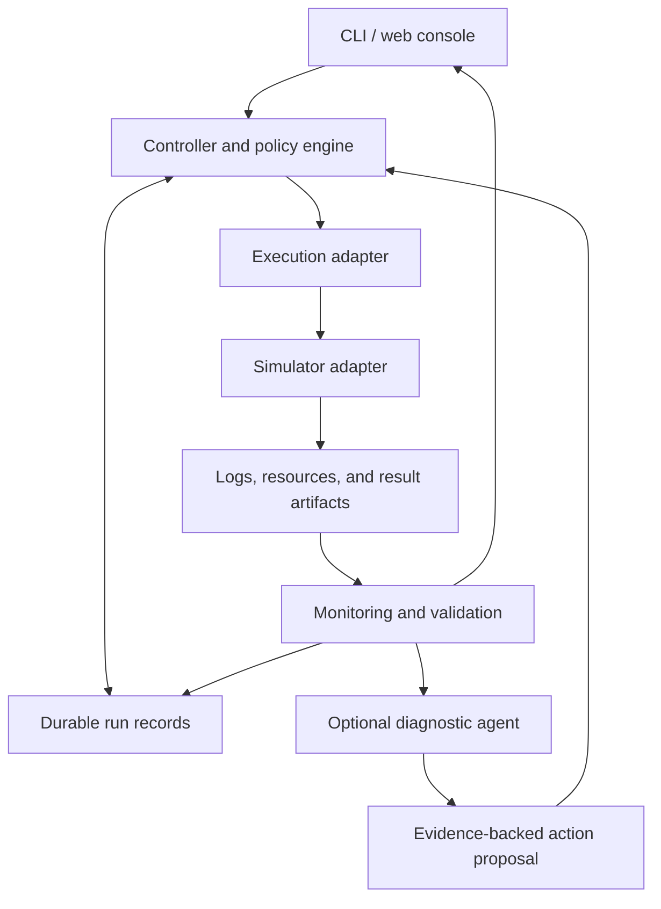

<p align="center">
  
</p>

<h1 align="center">SpiceOwl</h1>

<p align="center"><strong>You sleep. SpiceOwl keeps watch.</strong></p>
<p align="center">An open-source agent console for long-running circuit simulations.</p>
<p align="center">English · <a href="README.zh-CN.md">简体中文</a> · <a href="docs/architecture.md">Architecture</a> · <a href="docs/roadmap.md">Roadmap</a> · <a href="CONTRIBUTING.md">Contributing</a></p>

> **Early development — documentation and directory scaffold.** There is no runnable monitoring service, simulator integration, or CLI yet. Capabilities below describe the intended product; implementation will follow the [milestones](docs/roadmap.md).

## Why SpiceOwl

You start a simulation before leaving the lab. In the morning, the connection is gone, a job ran out of memory, or the run finished without the signals needed for your measurement.

SpiceOwl is being built to turn that uncertainty into a clear record: what ran, what happened, which recovery actions were taken, and whether the resulting data answers the intended experiment.

Our first target is **analog and mixed-signal research using Virtuoso and Spectre**, beginning with one validated Linux execution environment. Public development will use synthetic fixtures and a mock executor so contributors can participate without a commercial simulator or PDK.

## What we are building

| Capability | Intended behavior | Status |
| --- | --- | --- |
| Connect | Manage user-owned agent runtimes and model APIs with explicit auth, capability, and usage boundaries | Design drafted |
| Observe | Track execution identity, simulation progress, logs, memory, and disk usage | Planned |
| Reconnect | Reconcile an existing job after a client or controller interruption | Planned |
| Validate | Check inputs, required signals, measurement windows, and result completeness | Planned |
| Recover | Apply bounded, recorded recovery policies for supported failures | Planned |
| Diagnose | Use an optional agent to explain evidence and propose actions | Planned |
| Report | Separate execution outcome, measurement validity, and circuit performance | Planned |

### A morning report should answer three different questions

| Question | Example answer |
| --- | --- |
| Did the simulator finish? | Execution completed |
| Is this a valid measurement of the requested experiment? | Inputs matched; required signals and time window are present |
| Did the circuit meet its specification? | No — settling time exceeded the target |

A valid result that misses a design target is still a result worth preserving. Recovery must not change the experiment simply to turn a failure into a pass.

The report also shows observation freshness separately, so an old running status is not mistaken for a current observation.

## Design principles

- **Execution survives the interface.** A remote execution service or scheduler owns the job; the browser and agent conversation do not.
- **Unknown is a real state.** A missing connection is not proof of a failed simulation. Reconcile the original job before considering another submission.
- **Rules keep watch; agents investigate.** Routine monitoring and known recovery policies should work without an LLM. An agent proposes structured actions that the policy layer evaluates.
- **Every attempt has provenance.** Preserve the resolved inputs, tool identity, execution receipt, evidence, and changes between attempts.
- **Recovery preserves experimental intent.** Changes to tolerances, stimuli, corners, seeds, or measurement definitions require an explicit policy or a reviewed new experiment.
- **Resume means what the backend supports.** Controller recovery, job reconnection, and solver checkpoint recovery are separate capabilities.

## Planned architecture



The [architecture](docs/architecture.md) defines ownership and failure handling. The [run contract](docs/run-contract.md) defines what must be recorded before an experiment can be trusted.

The immediate implementation priority is **agent and API connection management**. The [integrated implementation plan](docs/design/integration-plan.md) starts with an offline fake-backed connection demo, followed by native local Codex and an API-key route, then ACP expansion. The [three design workstreams](docs/design/README.md) cover AI connections, simulator connections, and simulation debugging under shared [interface boundaries](docs/contracts/interface-boundaries.md).

## Repository map

```text
spiceowl/
├── README.md                  # English introduction
├── README.zh-CN.md            # Chinese introduction
├── docs/                      # Architecture, run contract, roadmap, decisions
├── assets/brand/              # Editable project icon and exported avatar
├── examples/                  # Draft experiment, connection and policy examples
├── src/spiceowl/               # Reserved Python implementation boundaries
│   ├── domain/                # Experiment, attempt, receipt, and event models
│   ├── adapters/              # Execution and simulator integrations
│   ├── monitoring/            # Observation and failure classification
│   ├── validation/            # Input and measurement acceptance checks
│   ├── recovery/              # Policy evaluation and action proposals
│   ├── storage/               # Durable records and artifact references
│   ├── agent/                 # Connections, sessions and optional diagnosis
│   └── cli/                   # Future local command interface
└── tests/                     # Validation plan and synthetic fixtures
```

The source directories are placeholders, not implemented modules. The [foundation decision](docs/decisions/0001-project-foundation.md) explains which technology choices are provisional.

## Start here

There is no package to install yet. To explore the design:

```bash
git clone https://github.com/joshuazeng713/spiceowl.git
cd spiceowl
python3 -m json.tool examples/run-manifest.example.json
```

1. Read the [first milestone and acceptance criteria](docs/roadmap.md).
2. Inspect the [illustrative manifest](examples/run-manifest.example.json) and its [field definitions](docs/run-contract.md).
3. Review the [synthetic failure scenario](tests/fixtures/synthetic/disconnected-running.json).
4. Contribute a reproducible failure case or an implementation scoped to a milestone.

The first implementation milestone is **connection management with fake-backed contracts**, followed by individually verified agent/API integrations. The first simulation milestone remains a **read-only monitor with a mock executor**. Real Spectre support will require an explicitly tested version and execution profile.

## Contributing

We welcome analog designers, CAD engineers, and developers working on reliable scientific computing. Useful first contributions include sanitized failure cases, measurement validators, and small implementations with failure-injection tests.

Read [CONTRIBUTING.md](CONTRIBUTING.md) before sharing data. Use [SECURITY.md](SECURITY.md) for reporting vulnerabilities and handling sensitive materials. Background references and candidate dependencies are listed in [docs/references.md](docs/references.md); no third-party framework is integrated yet.

## License

[MIT](LICENSE), as selected for this repository. Cadence tools, PDKs, and third-party components are not distributed by this project. Any future third-party code retains its applicable license and notices.
