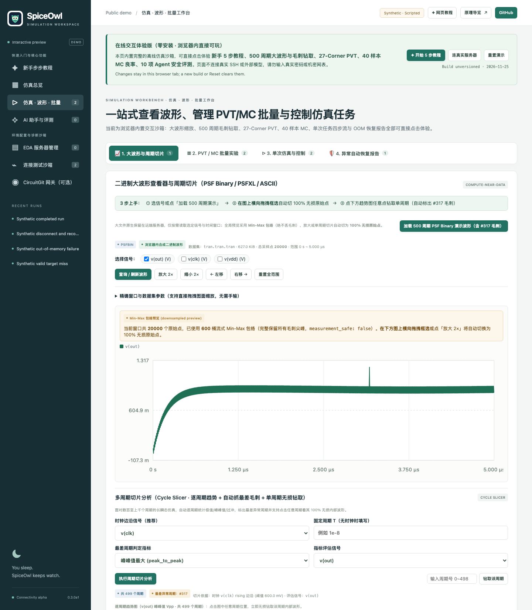
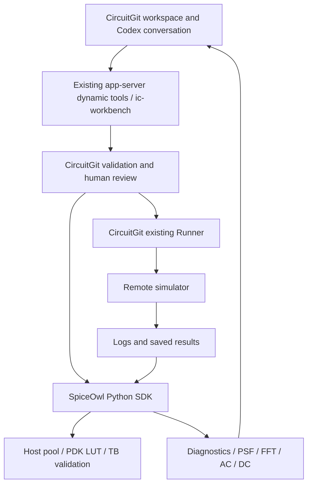

<p align="center">
  
</p>

<h1 align="center">SpiceOwl</h1>

<p align="center"><strong>You sleep. SpiceOwl keeps watch.</strong></p>
<p align="center">An independent simulation management tool for engineers and AI agents.</p>
<p align="center">English · <a href="README.zh-CN.md">简体中文</a> · <a href="docs/direct-execution.md">Direct Execution &amp; Recovery</a> · <a href="docs/cross-platform.md">Cross-Platform &amp; CI</a> · <a href="docs/architecture.md">Architecture</a> · <a href="docs/roadmap.md">Roadmap</a> · <a href="CONTRIBUTING.md">Contributing</a></p>

<p align="center"><a href="https://spiceowl-dev.github.io/spiceowl/#quickstart"><strong>Try the 5-step interactive Web UI tutorial (no install)</strong></a> · <a href="https://spiceowl-dev.github.io/spiceowl/#direct">Interactive 500-cycle Waveform &amp; PVT Workbench</a> · <a href="https://spiceowl-dev.github.io/spiceowl/workflow.html">Product showcase</a> · <a href="https://github.com/spiceowl-dev/spiceowl/tree/main">Current alpha source</a></p>

SpiceOwl has its own web console, Agent conversation, CLI and Python SDK — running natively on **macOS, Linux, and Windows**. It helps you check server capacity, configure PDK dependencies, prepare experiments, launch and supervise direct SSH/LSF/Slurm runs, apply bounded automatic recovery with searchable reports, and interpret simulation results. Engineers can use its tools directly or work with an Agent; embedding those tools in a circuit design environment is an optional integration.

## What's new

- **Redesigned beginner-friendly Web UI & full zero-CLI `github.io` interactive sandbox** ([Try live in your browser](https://spiceowl-dev.github.io/spiceowl/#quickstart)): Explore **every core workflow directly on GitHub Pages with zero installation or CLI** — walk through the **5-step interactive Web UI tutorial** (`#quickstart`), use **Dual Cursors A/B (`Δt / 1/Δt / ΔV / |ΔV/Δt|`)**, **1-click Lossless Analog Metrics**, **Multi-Corner `tt/ss/ff` Overlay Comparison**, and **CSV/SVG Export** on the **500-cycle PSF Binary waveform & `#317` Cycle Slicer**, explore the **27-Corner PVT matrix & 40-Sample Monte Carlo histogram**, step through `Stage → Launch → Status → Collect`, preview **Feishu / DingTalk / Slack / Generic overnight watch alert cards**, and run the **10-case Agent safety benchmark** (`#agents`). Backed by real Chromium Playwright desktop & mobile (`390px`) E2E checks in [`.github/workflows/tests.yml`](.github/workflows/tests.yml).
- **Generic lossless analog measurement recipes (M3), remote EDA `remote_env` profiles & Agent-first overnight watch handoff**: Built-in pure-Python lossless measurement engine (`spiceowl.experiments.analog_metrics`) computes rise/fall time, settling time, overshoot/undershoot, slew rate, period/duty/jitter, AC DC-gain/UGBW/phase-margin, and DC static power (wired into PVT/MC specs and `#direct`). Direct execution supports strictly validated remote environment bootstrap (`module load`, `setup_scripts`, `extra_path`), 5 zero-PDK starter netlist templates (RC, RLC ringing, two-pole op-amp AC, Level-1 CMOS inverter, ngspice RC), restart-safe incremental log streaming (`spiceowl.monitoring.log_stream`), and **Web-recorded Agent Watch Handoff (`spiceowl.watch_handoff`)**: zero external chat pings to wake the human — queue timeouts, OOMs, and license stalls are recorded quietly in the Web UI and pushed directly to the user's connected Agent, which checks host resources and submits traceable new attempts inside explicit `OvernightAutonomyPolicy` guardrails.
- **Cross-platform `spiceowl init` & `#quickstart` 4-step real EDA onboarding** ([legacy compatibility guide](docs/legacy-compatibility.md)): When you are ready to connect your own remote Linux EDA server locally (`spiceowl serve`), `#quickstart` Step 5 auto-discovers `~/.ssh/config` aliases (zero key/password reading), verifies Spectre/ngspice, freezes a zero-PDK RC smoke netlist, and runs your first simulation from the browser. Retired `spiceowl mcp` and legacy Q&A remain clearly documented as read-only compatibility archives.
- **Generic `next-action` orchestrator, interrupted-turn recovery & 10-case Agent E2E benchmark** ([reproducibility guide](docs/agent-reproducibility.md), [dual-mode Agent guide](docs/dual-mode-agent.md)): Deterministic 7-stage state machine (`spiceowl.orchestrator` / `spiceowl_next_action`) enforces missing-input preservation, uncertain-dispatch reconciliation, lossless measurement gates, and valid spec-failure preservation; `CodexBridge` supports explicit human-confirmed interrupted-turn archiving & unlock (`GET /api/codex/recovery`, `POST /api/codex/recover`) with zero silent replay; `spiceowl eval-agent` and `#agents` run the frozen 10-case benchmark comparing deterministic vs naive baselines (and custom model callbacks).
- **PVT / Corner / Monte Carlo batch experiment management** ([direct execution guide](docs/direct-execution.md)): Expand deterministic PVT matrices (`process × voltage × temperature`), seeded Monte Carlo suites, or hybrid `pvt_mc` batches with bounded `max_concurrency` dispatch, lossless metric extraction, conservative yield & `Cpk` statistics (failed and missing samples remain explicit in the denominator with full `mc_seed` identity), interactive corner matrix + SVG histogram in `#direct` (including 1-click 27-corner PVT & 40-sample Monte Carlo demos), CLI (`spiceowl direct batch-*`), and Markdown/CSV exports.
- **Binary waveforms (PSF Binary / PSFXL), compute-near-data downsampling & Cycle Slicer** ([direct execution guide](docs/direct-execution.md)): Inspect multi-thousand-cycle binary simulations without downloading gigabytes of raw files. Streams `psfbin`, `psfxl`, and `psfascii` via `seek()` locally or in-place on the remote Linux host; uses **Min-Max envelope downsampling** (`downsampled_preview`) so narrow glitches and overshoot are never lost, automatically switches to **100% lossless samples** (`exact_window`) when zooming in, and provides a **Cycle Slicer** with per-cycle trend charts, automatic worst-case anomaly detection, eye overlay, and 1-click lossless intra-cycle drill-down directly in `#direct` (including a built-in 500-cycle PSF Binary demo).
- **Native cross-platform support (macOS / Linux / Windows) & automated test workflow** ([cross-platform guide](docs/cross-platform.md)): SpiceOwl's local control plane detects your OS automatically via [`src/spiceowl/_platform.py`](src/spiceowl/_platform.py) — no WSL required on Windows. Every push and PR runs a 17-job **Ubuntu, macOS, and Windows** matrix ([`.github/workflows/tests.yml`](.github/workflows/tests.yml)) plus an AST static guardrail (`tests/test_cross_platform.py`). New developers and users can run full local verification in one command with `scripts/run_full_tests.py`.
- **Standalone direct execution (`ssh_direct`, `lsf`, `slurm`)** ([direct execution guide](docs/direct-execution.md)): Submit Spectre or ngspice simulations directly over registered OpenSSH hosts from the `#direct` web console, `spiceowl direct` CLI, or `--enable-direct-exec` Agent tools — no CircuitGit gateway required. Preserves frozen SHA-256 input manifests, atomic launch-claim fencing (`launch_outcome_unknown` on disconnect), verified PID/job cancellation, background `RuntimeMonitor` watches, and five-dimensional reports.
- **M4 bounded automatic recovery & searchable recovery reports** ([direct execution guide](docs/direct-execution.md)): Opt-in, policy-bounded recovery for two operational failures only — `license_unavailable` (backoff retries) and `confirmed_oom` (memory scale-up and optional host relocation) — with restart-safe watch resumption. Never alters netlists, stimuli, corners, or acceptance criteria, and refuses to auto-retry syntax/convergence failures or design target misses. Every recovery lineage writes searchable JSON + Markdown reports in the `#direct` console (with one-click `.md` download) and via `spiceowl direct recovery-reports`.

## Product showcase

**[Explore SpiceOwl: let an Agent help manage every simulation](https://spiceowl-dev.github.io/spiceowl/workflow.html)**

- Try server selection with CPU, memory and observation freshness, and follow PDK discovery, configuration and LUT reuse.
- See how users, Agents and execution tools cooperate: Agent setup, testbench preparation, submission identity, long-running supervision and disconnect diagnosis.
- Inspect real Spectre waveforms and metrics, including an improved spectrum with remaining SOA warnings, and explore the engineering behind resource checks, monitoring and numerical analysis.

The showcase distinguishes synthetic teaching controls from saved native simulation results and explains current capability boundaries. Opening it does not submit a simulation.

**Optional design integration:** [CircuitGit — AI-native local circuit design and Git version management](https://circuitgit-dev.github.io/CircuitGit/workflow/index.html). Its showcase explains how a design workbench can use SpiceOwl's tools alongside local circuit editing, Git history and testbench CI.

## Try the console

> **Try it in your browser — no installation.** Explore original synthetic runs, connection states and scripted diagnoses. SSH and simulation execution require a configured local runtime; Agent conversations use the standalone Codex window or CircuitGit's existing window in embedded mode. The public demo currently follows `main`; the [publishing guide](https://github.com/spiceowl-dev/spiceowl/blob/main/docs/github-pages.md) explains automatic updates.

> **Early alpha — simulation management from SpiceOwl's own console or CLI.** Scan an authorized server pool, submit committed inputs, observe existing runs in the background, apply opt-in M4 bounded recovery for license waits and confirmed OOM, and explicitly collect results. SpiceOwl provides monitoring, Spectre diagnostics, PSF ASCII parsing and numerical analysis. Remote execution supports both the [native direct execution backend](docs/direct-execution.md) (`ssh_direct`, `lsf`, and `slurm` directly over registered OpenSSH hosts via `spiceowl direct`, `#direct` web console, or `--enable-direct-exec`) and the optional CircuitGit Service/Runner adapter. The public demo executes no simulation; solver checkpoint continuation and automatic numerical-parameter repair remain future work. Start with the [direct execution guide](docs/direct-execution.md), [cross-platform guide](docs/cross-platform.md), [standalone runtime guide](docs/standalone-runtime.md), [console guide](docs/local-console.md), or [Agent setup guide](docs/dual-mode-agent.md).

**Two Agent modes:** standalone SpiceOwl owns one explicitly connected Codex App-Server window; embedded SpiceOwl exports tools into CircuitGit's existing window and never starts a second Agent. Authentication stays with the selected Codex runtime. See the [dual-mode guide](docs/dual-mode-agent.md). See the [paired integration and submodule contract](docs/circuitgit-integration.md).

[Simulation intake](docs/onboarding-discovery.md) parses imported circuit source, discovers selected SSH environments and model candidates, then freezes explicit experiment conditions through the configured backend. Discovery reports bounded coverage and never launches a simulator. Source extraction and model selection remain separate from scientific qualification.

[Guided onboarding](docs/smart-onboarding.md) adds source-backed device-contract prefill, ranked model/section choices, remote-platform TMI suggestions and editable experiment presets. The onboarding tools return exact next actions; missing evidence and uncertain submissions remain explicit.

The pure [cached scope selection SDK](docs/pdk-scope-selection.md) combines explicitly selected sections of one observed PDK entry, checks the full dependency namespace and TMI options, and compares a subsequent audit against every expected file hash and scope. It preserves partial-library status and requires the execution owner's fresh audit and review.

[Agent-authored testbenches](docs/agent-testbench.md) preserve Spectre source and reviewed relative Verilog-A helpers, including their standard-header dependency graph. A private [per-device PDK index](docs/pdk-lut.md) reuses an explicit library observation across different circuit model combinations, with visible age and coverage; execution still requires a fresh dependency audit. Optional [analysis tools](docs/adctools.md), installed with `pip install '.[adctools]'`, provide ten named Python/CLI operations, actual pinned ADCToolbox integration, and [native AC/DC parsing and measurements](docs/ac-dc-results.md). Gain and loop margins require explicit units, references and feedback semantics; DC region codes require a declared model contract. See the [agent reproducibility guide](docs/agent-reproducibility.md) for the deterministic steps and remaining limits.


*Redesigned web console overview with grouped navigation, four-dimensional run statuses, and instant 5-step tutorial entry.*


*Built-in 5-step interactive Web UI tutorial (`#quickstart`) guiding newcomers directly on GitHub Pages or local installs.*



*Four-tab `#direct` workbench showcasing 500-cycle PSF Binary Min-Max envelope preview, automatic lossless zoom-in, and Cycle Slicer `#317` glitch drill-down.*

## Why SpiceOwl

You start a simulation before leaving the lab. In the morning, the connection is gone, a job ran out of memory, or the run finished without the signals needed for your measurement.

SpiceOwl is being built to turn that uncertainty into a clear record: what ran, what happened, which recovery actions were taken, and whether the resulting data answers the intended experiment.

Our first target is **analog and mixed-signal research using Virtuoso and Spectre**, beginning with one validated Linux execution environment. Public development will use synthetic fixtures and a mock executor so contributors can participate without a commercial simulator or PDK.

## What we are building

| Capability | Intended behavior | Status |
| --- | --- | --- |
| Connect | Standalone Codex window or embedded CircuitGit window | Explicit App-Server connection, SSE, human review and shared SDK tools; no second Agent when embedded |
| Observe | Track execution identity and observation freshness | Existing-run monitor with bounded status calls/backoff, Spectre log evidence and aggregate host resource snapshots |
| Reconnect | Reconcile an existing job after a client or controller interruption | Exact submission-key lookup, fixed-run status and durable client requests; unknown dispatch is never replayed |
| Validate | Check inputs, required signals, measurement windows, and result completeness | Frozen inverter/prepared-transient recipes, finite authored-TB validation, and optional named ADC algorithms; general TB intent remains explicit |
| Recover | Apply bounded, recorded recovery policies for supported failures | Opt-in bounded M4 recovery implemented for direct runs (watch resume, license backoff retry, confirmed OOM scale-up/relocation + searchable JSON/Markdown recovery reports); native checkpoint continuation and numerical-parameter repair remain unimplemented |
| Diagnose | Explain evidence and propose actions | Deterministic Spectre classification and five-dimension reports; evidence is available in the standalone Agent conversation or an embedded host conversation |
| Report | Separate execution outcome, measurement validity, and circuit performance | Five independent experiment dimensions: execution, measurement, performance, operating qualification and dependency provenance |

### A morning report should answer three different questions

| Question | Example answer |
| --- | --- |
| Did the simulator finish? | Execution completed |
| Is this a valid measurement of the requested experiment? | Inputs matched; required signals and time window are present |
| Did the circuit meet its specification? | No — settling time exceeded the target |

A valid result that misses a design target is still a result worth preserving. Recovery must not change the experiment simply to turn a failure into a pass.

The report also shows observation freshness separately, so an old running status is not mistaken for a current observation.

## Design principles

- **Execution survives the interface.** A remote execution service or scheduler owns the job; the browser and agent conversation do not.
- **Unknown is a real state.** A missing connection is not proof of a failed simulation. Reconcile the original job before considering another submission.
- **Rules keep watch; agents investigate.** Routine monitoring and known recovery policies should work without an LLM. An agent proposes structured actions that the policy layer evaluates.
- **Every attempt has provenance.** Preserve the resolved inputs, tool identity, execution receipt, evidence, and changes between attempts.
- **Recovery preserves experimental intent.** Changes to tolerances, stimuli, corners, seeds, or measurement definitions require an explicit policy or a reviewed new experiment.
- **Resume means what the backend supports.** Controller recovery, job reconnection, and solver checkpoint recovery are separate capabilities.

## Integration architecture



The [architecture](docs/architecture.md) defines ownership and failure handling. The [run contract](docs/run-contract.md) defines what must be recorded before an experiment can be trusted.

The current [standalone runtime](docs/standalone-runtime.md) uses server-pool and execution-origin SDKs with CircuitGit's existing Runner. **Agent ownership is explicit:** standalone uses SpiceOwl's Codex window; embedded uses CircuitGit's existing `codex app-server` dynamic-tool bridge and `ic-workbench` integration. Historical [P0.2](docs/contracts/p02-connectivity.md), [P0.3](docs/contracts/p03-pool-agent.md) and connection designs remain for compatibility context; their separate Agent/MCP setup is superseded.

## Repository map

```text
spiceowl/
├── README.md                  # English introduction
├── README.zh-CN.md            # Chinese introduction
├── docs/                      # Architecture, run contract, roadmap, decisions
├── assets/brand/              # Editable project icon and exported avatar
├── examples/                  # Original inverter and draft configuration examples
├── scripts/                   # Developer setup, one-command cross-platform test runner & smoke tools
├── src/spiceowl/              # Installable Python package
│   ├── _platform.py           # Centralized macOS / Linux / Windows compatibility layer
│   ├── direct.py              # Standalone SSH/LSF/Slurm direct execution & recovery supervisor
│   ├── domain/                # Experiment, attempt, receipt, and event models
│   ├── adapters/              # Execution (SSH, direct/LSF/Slurm, mock) and simulator integrations
│   ├── integrations/          # CircuitGit client/pool, diagnostics and PSF ASCII parsing
│   ├── experiments/           # Source extraction, frozen recipes and deterministic measurements
│   ├── onboarding/            # Authored-TB validation, model discovery and private observation LUT
│   ├── adctools/              # Optional explicit ADC algorithms and pinned upstream adapters
│   ├── monitoring/            # Durable observation of existing real runs
│   ├── validation/            # Input and measurement acceptance checks
│   ├── recovery/              # M4 bounded recovery engine, searchable reports & policy evaluation
│   ├── storage/               # Durable records and artifact references
│   ├── agent/                 # Synthetic diagnosis and historical native compatibility
│   ├── read_api.py            # Transport-neutral stored read views for CircuitGit
│   ├── mcp/                   # Historical MCP compatibility shim and protocol tests
│   ├── scheduling/            # Resource placement and simulation-origin plans
│   ├── cli/                   # Local command interface
│   └── web/                   # Loopback API and bundled browser assets
└── tests/                     # Offline tests and synthetic fixtures
```

The independently maintained SDK/CLI contains server-pool probes, PDK discovery/LUT, Agent-TB checks, diagnostics, PSF parsing, adctools, read views and the existing signed simulation client. Conversation ownership follows the explicit mode; CircuitGit retains project materialization, execution identity, review, dispatch and native collection. Its `submodules/spiceowl` gitlink and integration lock pin the same reviewed commit. The [local console guide](docs/local-console.md) explains the separate demo and real-simulation views. The [foundation decision](docs/decisions/0001-project-foundation.md) records the original design choices.

## Start here

For a complete development environment, run `python3 scripts/setup_dev.py`
after cloning, then `.venv/bin/spiceowl serve --demo`. Setup installs the pinned
numerical extras and historical MCP test dependencies, downloads a project-local Python if needed, and runs
a quick self-check. Use `--serve-demo` to install and start in one command.
See [developer setup](docs/developer-setup.md) for requirements and recovery.

With Python 3.11+ on macOS, Linux, or Windows (see [cross-platform guide](docs/cross-platform.md)):

```bash
# macOS / Linux
git clone https://github.com/spiceowl-dev/spiceowl.git
cd spiceowl
python3 -m venv .venv
.venv/bin/python -m pip install .
.venv/bin/spiceowl serve --demo
```

```powershell
# Windows (PowerShell)
git clone https://github.com/spiceowl-dev/spiceowl.git
cd spiceowl
py -3 -m venv .venv
.venv\Scripts\python.exe -m pip install .
.venv\Scripts\spiceowl.exe serve --demo
```

Open the printed loopback URL. Explore Connections, inspect a synthetic run, advance its observations and request a demo diagnosis. No model, simulator, Node.js or credentials are needed. Repeating `--demo` preserves stored history. The [guide](docs/local-console.md) covers CLI commands, persistence, limitations and tests.

To verify your installation locally across all features (macOS, Linux, or Windows), run the one-command test workflow:

```bash
# macOS / Linux
.venv/bin/python scripts/run_full_tests.py

# Windows (PowerShell)
.venv\Scripts\python.exe scripts\run_full_tests.py
```

GitHub Actions automatically runs this full matrix on **macOS, Windows, and Ubuntu** ([`.github/workflows/tests.yml`](.github/workflows/tests.yml)); see [cross-platform support & testing](docs/cross-platform.md) for compatibility rules and ongoing maintenance.

To add a real connection, use **Simulation hosts → Add host**, or import an operator-authored host profile using `spiceowl hosts add --file PROFILE.json`. Registration saves local configuration; **Check connection** explicitly verifies the selected host. OpenSSH uses your existing alias and jump-host configuration. The [host onboarding guide](docs/host-onboarding.md) explains setup, safe retries and separate trust, authentication, network and stale-resource states. Version queries do not establish license availability, job state, or simulation validity.

When an existing SpiceOwl history store is the intended source, CircuitGit can read it with `spiceowl.read_api.open_read_views(directory)`; no MCP dependency, process or second conversation is needed. CircuitGit's own Runner records remain authoritative and need no duplicate store. The same eight bounded views are available through `spiceowl --data-dir ABSOLUTE_STATE_DIR read ...`. See the [SDK method mapping](docs/circuitgit-integration.md#direct-sdk-read-views). The old `spiceowl mcp` launcher now returns migration guidance; importable MCP symbols and the optional extra remain for historical protocol tests.

For multiple nodes, use **Simulation hosts → Import pool** to preview an explicit hostname list and register it using an existing route template, or use `hosts import-pool`. Select up to 32 rows and use **Check selected hosts**; the CLI offers `hosts scan --hosts HOST_ID ...`. The browser evaluates requested CPUs and memory within the same selected batch. Unknown or stale nodes are excluded. Placement retains a resource margin and is a proposal, not a reservation. Standalone plans select a candidate for a new exported netlist; Virtuoso-managed plans preserve the original host/native run mapping.

For AI assistance, use **Agent channel in standalone SpiceOwl** and explicitly Connect, or **CircuitGit's existing Codex conversation** when embedded. Both share engine tools and preserve saved legacy Q&A. See the [dual-mode setup](docs/dual-mode-agent.md). Legacy `agents add/probe/ask` commands return migration guidance; metadata and question history remain readable. See the [unified Agent channel guide](docs/native-agent.md).

## Connect the real simulation console

### Option 1: Standalone direct execution (no CircuitGit gateway needed)

Register an SSH host, then prepare, launch, watch, recover, and collect directly from the web console (`#direct`) or CLI (`spiceowl direct`):

```bash
# Freeze inputs with opt-in M4 bounded recovery (license retries + OOM scale-up/relocation)
spiceowl direct prepare --run-key amp-tran-01 --netlist ./amp.scs --host lab-sim --backend slurm \
  --enable-recovery --max-recovery-attempts 2 --max-memory-gb 32 --allow-host-relocation
spiceowl direct stage amp-tran-01
spiceowl direct launch amp-tran-01
spiceowl direct watch amp-tran-01 --allow-collect --auto-resume-watch

# Search and inspect persisted recovery reports (also viewable & downloadable in the #direct web console)
spiceowl direct recovery-reports --query oom
spiceowl direct recovery-report amp-tran-01 --markdown
```

Add `--enable-direct-exec` to `spiceowl serve` to also expose these direct execution and recovery tools (with human approval gates) to the standalone Codex window. See the [direct execution & bounded recovery guide](docs/direct-execution.md).

### Option 2: Connect through a CircuitGit gateway

Provision a private [live-client configuration](examples/live-client.example.json) for an authorized, running CircuitGit gateway, then use the same file for CLI and web:

```bash
spiceowl live --client-config /absolute/private/live-client.json runtime
spiceowl serve --live-client-config /absolute/private/live-client.json
```

The [standalone runtime guide](docs/standalone-runtime.md) covers server grants, exact project/configuration/commit identity, explicit submission and collection, and unknown-request lookup. This path executes prepared netlists with remote Spectre without launching Virtuoso or OCEAN. The local client needs no PDK files; licensed models, alias mappings, hash pins and a working simulator license must exist in the remote execution environment when the circuit needs them. Keep the CircuitGit service running for background observation. Current `watch` observes an existing run; it does not automatically collect, restart a solver or change parameters.

For registered experiments, [`spiceowl workflow`](docs/workflow.md) provides a deterministic `prepare → run → inspect` CLI, plus `execute` to wait through collection and five-dimensional reporting. It needs no LLM and preserves the original plan/job/key on timeout or uncertain dispatch. Recipe preparation checks remote dependencies; inspection can collect terminal results. Scientific conditions remain frozen and automatic parameter repair is not implemented.

## Developer inverter smoke test

The source-checkout utility [run_inverter_smoke.py](scripts/run_inverter_smoke.py) provides an explicit `prepare → stage → launch → status → collect` workflow for the [original toy MOS1 inverter](examples/inverter/README.md). It requires a registered, authorized Linux host with licensed Spectre, GNU `timeout`, and a working Python 3.6+ interpreter. Replace `HOST_ID` with a registered host ID and `PYTHON_ABSOLUTE_PATH` with that remote interpreter's absolute path. Run the steps individually and inspect each result before continuing:

```bash
PYTHONPATH=src .venv/bin/python scripts/run_inverter_smoke.py prepare --data-dir .spiceowl --hosts HOST_ID --run-key inverter-smoke-001 --remote-python PYTHON_ABSOLUTE_PATH
PYTHONPATH=src .venv/bin/python scripts/run_inverter_smoke.py stage --run-dir .spiceowl/smoke/inverter-smoke-001
PYTHONPATH=src .venv/bin/python scripts/run_inverter_smoke.py launch --run-dir .spiceowl/smoke/inverter-smoke-001
PYTHONPATH=src .venv/bin/python scripts/run_inverter_smoke.py status --run-dir .spiceowl/smoke/inverter-smoke-001
PYTHONPATH=src .venv/bin/python scripts/run_inverter_smoke.py collect --run-dir .spiceowl/smoke/inverter-smoke-001
```

If the remote launch environment needs explicit license configuration, append the optional `--license-env-json PRIVATE_LICENSE_JSON_PATH` to **prepare**. The private JSON object accepts only `CDS_LIC_FILE` and/or `LM_LICENSE_FILE`; their values are frozen in the private plan and passed to the solver environment. Omit the option when the existing environment is already configured. A successful version check does not prove that a simulation license is available. See the [example guide](examples/inverter/README.md) for the JSON shape; keep actual license configuration out of public source and shared receipts.

`prepare` actively checks the selected hosts and freezes a local source/acceptance bundle; it does not reserve resources or launch a job. `stage` writes the frozen input to an isolated remote directory. `launch` rechecks resource headroom, verifies the remote identity/version and claims one bounded attempt. If delivery is uncertain, use `status` with the same saved run directory; do not prepare a new key or blindly relaunch. Collect only after a confirmed terminal result. Collection checks hashes and completion evidence, saves native PSF ASCII and logs, and produces separate execution, measurement-validity and toy-inverter results. Optional `collect --plots` needs a separately installed local matplotlib.

Keep `.spiceowl/smoke/` private. The original educational models represent no fabrication process, and a passing smoke test does not qualify a PDK or unattended recovery. This utility remains a separate developer workflow. The optional real CLI/web client dispatches through CircuitGit’s existing Runner; SDK cache queries and placement-only commands retain their read-only or planning scope. Limits and acceptance criteria are documented with the [example](examples/inverter/README.md).

SpiceOwl also connects to IC Workbench through a bounded, read-only gateway adapter. Use `ic register`, `ic sync`, and `ic runs` to preserve native run IDs and inspect stored observations; three transport-neutral SDK methods expose the local cache to CircuitGit. IC Workbench retains the existing submission/approval workflow and hosts a compact supervision card. That passive cache interface does not enable monitoring or automatic recovery. The optional real client enables explicit watches separately. See the [IC Workbench integration guide](docs/ic-workbench.md).

CircuitGit can use the [external resource-selection API](docs/circuitgit-integration.md#resource-aware-execution-through-circuitgit) to scan a configured server pool, freeze the selected site in a reviewed plan and recheck it before its existing Runner submits the simulation. Stored runs carry optional historical library/cell and execution-target metadata. SpiceOwl’s optional real CLI/web entry point reuses that same Runner, and cached SDK views remain read-only. Both repositories’ simulation integration is delivered and tested together.

## Contributing

We welcome analog designers, CAD engineers, and developers working on reliable scientific computing. Useful first contributions include sanitized failure cases, measurement validators, and small implementations with failure-injection tests.

Read [CONTRIBUTING.md](CONTRIBUTING.md) before sharing data. Use [SECURITY.md](SECURITY.md) for reporting vulnerabilities and handling sensitive materials. Background references and candidate dependencies are listed in [docs/references.md](docs/references.md). The core uses Python's standard library. The optional MCP extra is retained only for historical compatibility and protocol tests; CircuitGit's SDK integration does not require it.

## License

[MIT](LICENSE), as selected for this repository. Cadence tools, PDKs, and third-party components are not distributed by this project. Any future third-party code retains its applicable license and notices.
