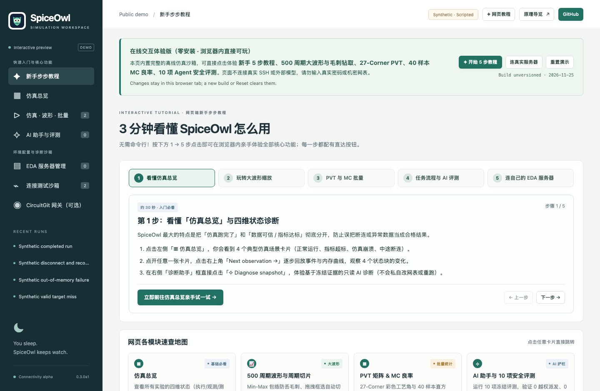

<p align="center">
  
</p>

<h1 align="center">SpiceOwl · 仿真夜枭</h1>

<p align="center"><strong>你去休息，仿真我盯。</strong></p>
<p align="center">面向工程师与 AI Agent 的独立仿真管理工具。</p>
<p align="center"><a href="README.md">English</a> · 简体中文 · <a href="docs/direct-execution.md">直连执行与有界恢复</a> · <a href="docs/cross-platform.md">跨平台与自动测试</a> · <a href="docs/architecture.md">架构设计</a> · <a href="docs/roadmap.md">开发路线</a> · <a href="CONTRIBUTING.md">参与贡献</a></p>

<p align="center"><a href="https://spiceowl-dev.github.io/spiceowl/#quickstart"><strong>零安装在线体验 5 步网页教程</strong></a> · <a href="https://spiceowl-dev.github.io/spiceowl/#direct">在线玩 500 周期大波形与 PVT 矩阵</a> · <a href="https://spiceowl-dev.github.io/spiceowl/workflow.html">产品展示页</a> · <a href="https://github.com/spiceowl-dev/spiceowl/tree/main">当前 Alpha 源码</a></p>

SpiceOwl 有自己的网页控制台、Agent 会话、CLI 和 Python SDK，**原生支持 macOS、Linux 与 Windows**。它帮助你检查服务器资源、配置 PDK 依赖、准备实验、直接提交与监督 SSH/LSF/Slurm 仿真任务、执行带可搜索报告的有界自动恢复，并解释仿真结果。工程师可以直接使用这些工具，也可以与 Agent 协作；将工具嵌入电路设计环境是可选的集成方式。

## 最新功能亮点

- **全新新手友好网页端 UI + `github.io` 零命令行全功能在线交互沙箱**（[立即在浏览器里直接玩](https://spiceowl-dev.github.io/spiceowl/#quickstart)）：**无需安装、无需打开命令行**，打开 GitHub Pages 即可直接点击体验全部核心功能——包括 **5 步交互式网页新手教程**（`#quickstart`）、**4 标签聚焦工作台**（`#direct`）、**500 周期 PSF Binary 拖拽无损缩放与 `#317` 毛刺钻取**、**27-Corner PVT 矩阵与 40 样本 Monte Carlo 直方图（支持导出 MD/CSV）**、`Stage → Launch → Status → Collect` 沙箱全流程、**M4 OOM 恢复审计报告**以及 **10 项 Agent 安全评测**（`#agents`）。每次提交均由 [`.github/workflows/tests.yml`](.github/workflows/tests.yml) 中的真实 Chromium Playwright（桌面端 + 390px 移动端）自动回归验证。
- **跨平台 `spiceowl init` 与 `#quickstart` 第 5 步真实 EDA 服务器接入**（[历史兼容层说明](docs/legacy-compatibility.md)）：需要连接自己的远程 Linux EDA 服务器时，在本地运行 `spiceowl serve` 并打开 `#quickstart` 第 5 步，自动识别本机 `~/.ssh/config` 别名（绝不读取私钥或密码）、一键验证 SSH 与 Spectre/ngspice 版本、内置零 PDK 依赖的 RC 烟雾网表并在网页端跑通首个真实仿真。历史 `spiceowl mcp` 与旧版 Q&A 已清晰归档为只读兼容层。
- **通用确定性 `next-action` 编排器、中断回合安全恢复与 10 项 Agent 端到端闭环评测**（[Agent 可复现指南](docs/agent-reproducibility.md)、[双模式 Agent 指南](docs/dual-mode-agent.md)）：纯确定性 7 阶段状态机（`spiceowl.orchestrator` / `spiceowl_next_action`）在工具层硬约束缺项拒猜、断连先对账、拒绝降采样科学量测与保留有效指标失败；`CodexBridge` 支持人工核对后显式归档并解除中断锁定（`GET /api/codex/recovery`、`POST /api/codex/recover`，有副作用调用必须二次确认且绝不静默重放）；`spiceowl eval-agent` 与 `#agents` 内置 10 项冻结闭环评测，可一键对比确定性编排器与弱模型基线（并支持接入外部真实模型回调）。
- **PVT / Corner / Monte Carlo 批量实验管理与保守良率统计**（[原生直连执行指南](docs/direct-execution.md)）：支持确定性展开 PVT 矩阵（`工艺角 × 电压 × 温度`）、带显式随机种子（`mc_seed`）的 Monte Carlo 采样及混合 `pvt_mc` 批量任务；按并发上限 `max_concurrency` 有序派发与收集、严格基于无损波形提取指标并计算 `μ / σ / P5 / P50 / P95 / Cpk` 及保守良率（执行失败与缺失样本绝不静默剔除，完整保留样本号与种子身份）；网页 `#direct` 内置 PVT 彩色矩阵、SVG 分布直方图、一键 27-Corner PVT 与 40 样本 Monte Carlo 演示及 Markdown/CSV 导出。
- **二进制大波形解析（PSF Binary / PSFXL）、远端原位降采样与多周期切片（Cycle Slicer）**（[原生直连执行指南](docs/direct-execution.md)）：无需将数 GB 原始波形全量下载到本地，直接通过 `seek()` 流式读取本地或远端 Linux 原位 `psfbin` / `psfxl` / `psfascii` 数据。全局概览采用 **Min-Max 包络降采样**（绝不丢毛刺与过冲），放大或单周期钻取自动切换为 **100% 原始无损点**（并严格禁止将降采样预览送入 `adctools` 科学测量）；内置 **Cycle Slicer** 逐周期趋势扫描、最差异常周期自动定位、多周期叠画（Eye Overlay）及点击钻取，并在 `#direct` 网页端提供一键 500 周期 PSF Binary 演示波形。
- **原生跨平台支持（macOS / Linux / Windows）与全功能自动测试工作流**（[跨平台兼容与测试指南](docs/cross-platform.md)）：本地控制端通过 [`src/spiceowl/_platform.py`](src/spiceowl/_platform.py) 自动识别操作系统，Windows 无需 WSL 即可原生运行。每次提交与 PR 均在 GitHub Actions 上执行覆盖 **Ubuntu、macOS、Windows** 的 17 项全功能测试矩阵（[`.github/workflows/tests.yml`](.github/workflows/tests.yml)），并由 AST 静态守卫（`tests/test_cross_platform.py`）持续防止后续开发引入不兼容 POSIX 调用。新开发者和用户可通过 `scripts/run_full_tests.py` 一键完成本地全量自检。
- **不依赖网关的原生直连仿真后端（`ssh_direct` / `lsf` / `slurm`）**（[原生直连执行指南](docs/direct-execution.md)）：通过网页 `#direct` 面板、`spiceowl direct` CLI 或 `--enable-direct-exec` Agent 工具，直接经已登记的 OpenSSH 主机提交、观测、取消并收集 Spectre / ngspice 仿真任务。全程保持 SHA-256 输入冻结、原子启动占位（断连记为 `launch_outcome_unknown` 拒绝盲重跑）、验证归属的 PID/作业取消、后台 `RuntimeMonitor` 观测及五维结构化报告。
- **M4 有界自动恢复与可搜索恢复报告中心**（[原生直连执行指南](docs/direct-execution.md)）：面向两类明确运维故障提供策略受控、可开关的自动恢复——**许可证不可用/排队超时 (`license_unavailable`)** 退避重提，以及**确认 OOM (`confirmed_oom`)** 内存扩配与可选大内存主机迁移，并支持服务重启自动续接后台 Watch。严守科学底线：绝不修改原始网表、激励、corner 或验收标准，绝不对语法/收敛错误或性能不达标自动重跑。每次恢复自动生成可按任务 ID、关键词、结论检索的 JSON + Markdown 报告，可在网页 `#direct` 报告中心查看与一键下载，或通过 `spiceowl direct recovery-reports` 查询。

## 产品展示

**[打开 SpiceOwl 展示页：让 Agent 帮你管理好每一次仿真](https://spiceowl-dev.github.io/spiceowl/workflow.html)**

- 交互体验 CPU、内存和观测时效如何影响服务器选择，了解 PDK 发现、配置与 LUT 复用。
- 看清用户、Agent 与执行工具如何协作：Agent 配置、测试平台编写、提交身份、长任务监督和断连诊断。
- 查看真实 Spectre 波形与指标，包括频谱改善后仍存在的 SOA 告警，并了解资源检查、监控和数值分析背后的工程实现。

展示页区分合成教学交互与已保存的原生仿真结果，说明当前能力边界。打开页面不会提交仿真。

**可选设计集成：** [CircuitGit · AI-native 本地电路设计与 Git 版本管理](https://circuitgit-dev.github.io/CircuitGit/workflow/index.html)。其展示页说明设计工作台如何结合本地电路编辑、Git 历史和测试平台 CI，调用 SpiceOwl 的仿真管理工具。

## 体验控制台

> **无需安装，打开即可体验。** 在线浏览原创合成仿真场景、连接状态和脚本化诊断。SSH 和仿真执行需要已配置的本地环境；独立使用时提供自己的 Codex 窗口，嵌入时复用 CircuitGit 的同一窗口。公开演示目前跟随 `main` 自动更新；发布方式见 [GitHub Pages 指南](https://github.com/spiceowl-dev/spiceowl/blob/main/docs/github-pages.md)。

**双模式 Agent：** 独立 SpiceOwl 在显式 Connect 后启动自己的 Codex App-Server 对话；作为 CircuitGit 子模块时只导出工具，复用其原有窗口，绝不启动第二个 Agent。认证由所选 Codex runtime 管理。见[双模式指南](docs/dual-mode-agent.md)。配对与子模块约定见[集成指南](docs/circuitgit-integration.md)。

[从零接入仿真](docs/onboarding-discovery.md)：通过已配置的后端解析导入电路源、探测选中的 SSH 环境和模型候选，再固定明确的实验条件。发现过程报告有限的搜索范围，不启动仿真；源文件提取、模型选择与科学有效性判定分别记录。

> **早期 Alpha：在 SpiceOwl 自己的控制台或 CLI 中管理仿真。** 检查已授权的服务器池、提交已冻结的输入、后台观察已有任务、对许可证等待和确认 OOM 启用可选的 M4 有界自动恢复，并显式收集结果。SpiceOwl 提供监控、Spectre 诊断、PSF ASCII 解析和数值分析。远端执行同时支持不依赖网关的[原生直连执行后端](docs/direct-execution.md)（通过 `spiceowl direct`、网页 `#direct` 面板或 `--enable-direct-exec` 直接经已登记 OpenSSH 路由运行 `ssh_direct` / `lsf` / `slurm`），以及可选的 CircuitGit Service/Runner 适配器。公开演示不执行仿真；求解器 checkpoint 续算和自动数值参数修复仍待实现。见[原生直连执行指南](docs/direct-execution.md)、[跨平台与测试指南](docs/cross-platform.md)、[独立仿真指南](docs/standalone-runtime.md)、[控制台指南](docs/local-console.md)和[Agent 配置指南](docs/dual-mode-agent.md)。

[引导式仿真接入](docs/smart-onboarding.md)提供有源码依据的器件定义预填、模型入口与 section 推荐、远端平台 TMI 匹配及可编辑的实验预设。接入工具返回明确的下一步动作；新 intake 使用自己的网表及明确绑定来源的观测，缺失证据和提交结果不确定的状态会明确保留。

纯函数[缓存作用域选择 SDK](docs/pdk-scope-selection.md)可组合同一已观察 PDK 入口中明确选定的多个 section，检查完整依赖中的模型重名与 TMI 选项，并逐项比较后续审计的文件哈希及作用域。全库的部分覆盖状态仍然保留，执行前始终需要运行方获取新审计并完成审阅。

[Agent 编写的测试平台](docs/agent-testbench.md)保留 Spectre 源码、经过审阅的相对路径 Verilog-A 辅助文件及标准头文件依赖闭包。私有[单器件 PDK 索引](docs/pdk-lut.md)让不同电路的器件组合复用同一次全库观测，保留覆盖范围和时间；执行前仍须重新核验依赖。安装 `pip install '.[adctools]'` 后，可使用十项具名[分析工具](docs/adctools.md)的 Python／CLI 接口、固定版本的真实 ADCToolbox 集成及[原生 AC/DC 解析与测量](docs/ac-dc-results.md)。增益和环路裕度须明确单位、参考信号与反馈定义，DC region 编码须来自明确模型约定。确定性步骤与限制见[Agent 可复现流程](docs/agent-reproducibility.md)。


*新版控制台总览：分组侧边栏、四维运行状态卡与一键 5 步教程入口。*



*内置 5 步交互式网页教程（`#quickstart`），在 GitHub Pages 与本地控制台均零门槛可用。*


*全新 4 标签 `#direct` 工作台：500 周期 PSF Binary Min-Max 包络预览、拖拽自动切无损与 Cycle Slicer `#317` 毛刺定位。*

## 为什么做 SpiceOwl

晚上启动仿真，第二天回来才发现连接断了、任务内存不足，或者仿真已经结束，却没有保存测量需要的信号。

SpiceOwl 希望把这些情况变成一份清晰的实验记录：执行了什么、哪里出现异常、采取过哪些恢复动作，以及结果能否回答原本的实验问题。

第一阶段面向 **使用 Virtuoso / Spectre 的模拟与混合信号研究**，从一个经过验证的 Linux 执行环境开始。公共开发使用模拟执行器和合成测试数据，让没有商业仿真器或 PDK 的贡献者也能参与。

## 计划实现的能力

| 能力 | 目标行为 | 当前状态 |
| --- | --- | --- |
| 接入 | 独立 Codex 窗口或嵌入 CircuitGit 原窗口 | 显式连接、SSE、人工审阅与共用 SDK；嵌入时不起第二个 Agent |
| 观察 | 跟踪任务身份与观测的新鲜程度 | 已有任务的后台状态监控、有限查询与退避、Spectre 日志证据和主机总体资源快照 |
| 重连 | 在客户端或控制器中断后核对并找回原任务 | 原提交 key 精确查询、固定任务状态查询与持久请求记录；结果未知的派发不重放 |
| 验收 | 检查输入、必需信号、测量窗口和结果完整性 | 固定条件的反相器／预备瞬态配方、有限语法的用户 TB 校验及可选 ADC 算法；通用 TB 仍须明确实验目的 |
| 恢复 | 对支持的故障执行有次数、资源边界且可追溯的恢复策略 | 直连后端已支持可选的 M4 有界恢复（重启恢复 watch、许可证退避重试、确认 OOM 内存扩配/主机迁移与可搜索 JSON/Markdown 恢复报告）；求解器 checkpoint 续算与数值参数修复未实现 |
| 诊断 | 解释证据并提出处理建议 | 确定性的 Spectre 分类与五维报告；可在独立 Agent 会话或嵌入宿主的会话中读取证据 |
| 报告 | 分别呈现执行结果、测量有效性和电路性能 | 五个独立实验维度：执行、测量、性能、工作条件检查与依赖来源 |

### 一份报告需要区分三个问题

| 问题 | 示例结论 |
| --- | --- |
| 仿真器运行完了吗？ | 执行完成 |
| 这次测量符合实验要求吗？ | 输入一致，信号齐全，测量窗口有效 |
| 电路性能达标了吗？ | 未达标：建立时间超过目标 |

测量有效但性能不达标，是需要保留的实验结果。恢复机制不能通过改变实验条件，把失败“修”成成功。

报告还会单独标明观测是否新鲜，避免把上次记录的“运行中”误认为当前状态。

## 设计原则

- **运行独立于界面。** 任务由远端执行服务或调度器管理，浏览器和 Agent 对话不拥有任务生命周期。
- **允许状态未知。** 连接丢失不等于仿真失败；再次提交前必须先核对原任务。
- **规则负责值守，Agent 负责调查。** 常规监控和已知恢复策略不依赖 LLM；Agent 提交结构化建议，由策略层判断是否执行。
- **每次尝试都可追溯。** 保留实际输入、工具身份、提交回执、异常证据，以及各次尝试之间的变化。
- **恢复保持实验含义。** 修改容差、激励、corner、随机种子或测量定义，必须符合明确策略，或形成经过审核的新实验。
- **按后端能力恢复。** 控制器重启、任务重连、求解器 checkpoint 续算是三种不同能力。

## 仓库目录

```text
spiceowl/
├── README.md                  # 英文项目介绍
├── README.zh-CN.md            # 中文项目介绍
├── docs/                      # 架构、实验约定、路线和设计决策
├── assets/brand/              # 可编辑图标与头像导出文件
├── examples/                  # 原创反相器与配置草案示例
├── scripts/                   # 开发者安装脚本、跨平台一键全量测试脚本与 smoke 工具
├── src/spiceowl/              # 可安装的 Python 软件包
│   ├── _platform.py           # 统一的 macOS / Linux / Windows 跨平台兼容层
│   ├── direct.py              # 独立 SSH/LSF/Slurm 直连执行与后台恢复监管
│   ├── domain/                # 实验、尝试、回执与事件模型
│   ├── adapters/              # 执行环境（SSH / Direct / LSF / Slurm / Mock）与仿真器适配
│   ├── integrations/          # CircuitGit 客户端／资源池、诊断与 PSF ASCII 解析
│   ├── experiments/           # 源码抽取、固定配方与确定性测量
│   ├── onboarding/            # 用户 TB 校验、模型发现与私有观测查找表
│   ├── adctools/              # 可选 ADC 算法及固定版本上游适配器
│   ├── monitoring/            # 已有真实任务的持久化观测
│   ├── validation/            # 输入和测量验收
│   ├── recovery/              # M4 有界自动恢复引擎、可搜索恢复报告与策略评估
│   ├── storage/               # 持久化记录与产物引用
│   ├── agent/                 # 合成诊断与历史 native 兼容代码
│   ├── read_api.py            # 供 CircuitGit 直接调用的只读 SDK 视图
│   ├── mcp/                   # 历史 MCP 兼容层和协议测试
│   ├── scheduling/            # 资源选址与仿真来源计划
│   ├── cli/                   # 本地命令入口
│   └── web/                   # 本地 API 与随包网页资源
└── tests/                     # 离线测试与合成案例
```

独立维护的 SDK／CLI 包含服务器池检查、PDK 发现与 LUT、Agent-TB 校验、诊断、PSF 解析、adctools、只读视图和已有签名仿真客户端。对话归属由显式模式决定；CircuitGit 继续负责项目物化、执行身份、审阅、派发和原生产物收集；其 `submodules/spiceowl` gitlink 与集成锁指向同一个经过审阅的提交。[本地控制台指南](docs/local-console.md)说明独立的演示与真实仿真视图；[架构文档](docs/architecture.md)和[实验约定](docs/run-contract.md)说明模块职责与可信实验的要求。

当前[独立仿真入口](docs/standalone-runtime.md)通过服务器池和仿真来源 SDK 复用 CircuitGit Runner。**Agent 采用显式双模式**：独立使用 SpiceOwl 自己的 Codex 窗口，嵌入时复用 CircuitGit 的 `codex app-server` 动态工具桥接／`ic-workbench` 集成。[P0.2](docs/contracts/p02-connectivity.md)、[P0.3](docs/contracts/p03-pool-agent.md) 和旧连接设计保留为历史资料，其中单独的 Agent／MCP 接入步骤已被替代。

## 从哪里开始

开发者下载仓库后，执行 `python3 scripts/setup_dev.py` 即可安装固定版本的完整
Python 开发环境、数值依赖及历史 MCP 测试依赖并自检；缺少合适的 Python 时会在项目内下载。
随后运行 `.venv/bin/spiceowl serve --demo`。加 `--serve-demo` 可合并安装与启动。
环境要求、重复安装和故障处理见[开发者环境说明](docs/developer-setup.md)。

在 macOS、Linux 或原生 Windows 上使用 Python 3.11 及以上版本（详见[跨平台兼容指南](docs/cross-platform.md)）：

```bash
# macOS / Linux
git clone https://github.com/spiceowl-dev/spiceowl.git
cd spiceowl
python3 -m venv .venv
.venv/bin/python -m pip install .
.venv/bin/spiceowl serve --demo
```

```powershell
# Windows (PowerShell)
git clone https://github.com/spiceowl-dev/spiceowl.git
cd spiceowl
py -3 -m venv .venv
.venv\Scripts\python.exe -m pip install .
.venv\Scripts\spiceowl.exe serve --demo
```

打开命令打印的本地网址，即可管理模拟连接、查看合成任务、推进观测并请求演示诊断。不需要模型、仿真器、Node.js 或凭据。重复使用 `--demo` 会保留已有历史；CLI、持久化和测试方式见[指南](docs/local-console.md)。

新开发者或用户可在本地一键运行覆盖全功能的自动化测试工作流（支持 macOS / Linux / Windows）：

```bash
# macOS / Linux
.venv/bin/python scripts/run_full_tests.py

# Windows (PowerShell)
.venv\Scripts\python.exe scripts\run_full_tests.py
```

仓库已配置 **macOS、Windows 与 Ubuntu** 三端自动 CI 工作流（[`.github/workflows/tests.yml`](.github/workflows/tests.yml)），跨平台规范与后续维护清单见[跨平台兼容与测试指南](docs/cross-platform.md)。

真实连接可在网页 **Simulation hosts → Add host** 中填写，或使用 `spiceowl hosts add --file PROFILE.json` 导入操作者编写的私有配置。登记只保存本地配置；**Check connection** 才显式检查所选主机。OpenSSH 复用已有别名和跳板配置。[主机接入指南](docs/host-onboarding.md)说明配置、重复保存及信任、认证、网络和资源过期的不同状态。版本查询不代表许可证可用、任务正在运行或仿真结果有效。

如需读取已有的 SpiceOwl 历史库，CircuitGit 可直接调用 `spiceowl.read_api.open_read_views(directory)`，无须 MCP 依赖、进程或第二个对话。CircuitGit 自己的 Runner 记录继续作为权威来源，无须另建重复存储。相同八个有限只读视图也可通过 `spiceowl --data-dir ABSOLUTE_STATE_DIR read ...` 使用，见[SDK 方法对照](docs/circuitgit-integration.md#direct-sdk-read-views)。旧 `spiceowl mcp` 命令只返回迁移指引；MCP 导入符号及可选依赖保留供历史兼容测试。

多节点场景可在 **Simulation hosts → Import pool** 中预览明确的主机名列表，并复用已有连接模板登记，也可使用 `hosts import-pool`。选择最多 32 台，执行 **Check selected hosts**；CLI 对应 `hosts scan --hosts HOST_ID ...`。网页在同一批选中主机中评估所需 CPU 和内存。未知或过期节点不参加选址；算法保留资源余量，但推荐不代表预留。独立网表计划为新任务选择候选节点，Virtuoso 管理的任务计划保留原主机和 native run 映射。

AI 辅助可在独立 SpiceOwl 的 **Agent channel** 中显式 Connect；嵌入时使用 **CircuitGit 原有 Codex 窗口**。两种方式调用共用引擎，旧问答继续只读保留。见[双模式连接指南](docs/dual-mode-agent.md)。旧 `agents add/probe/ask` 命令返回迁移指引，已有元数据和问答历史仍可读取。见[统一 Agent 通道指南](docs/native-agent.md)。

## 接入真实仿真控制台

### 方式一：原生直连执行（无需 CircuitGit 网关）

登记 OpenSSH 主机后，即可直接通过网页控制台 `#direct` 面板或 `spiceowl direct` CLI 完成准备、提交、后台观测、有界恢复与结果收集：

```bash
# 冻结输入并开启 M4 有界自动恢复（许可证退避重提 + OOM 内存扩配/主机迁移）
spiceowl direct prepare --run-key amp-tran-01 --netlist ./amp.scs --host lab-sim --backend slurm \
  --enable-recovery --max-recovery-attempts 2 --max-memory-gb 32 --allow-host-relocation
spiceowl direct stage amp-tran-01
spiceowl direct launch amp-tran-01
spiceowl direct watch amp-tran-01 --allow-collect --auto-resume-watch

# 搜索与查看持久化恢复报告（也可在网页 #direct 恢复报告中心搜索与一键下载 .md）
spiceowl direct recovery-reports --query oom
spiceowl direct recovery-report amp-tran-01 --markdown
```

启动 `spiceowl serve --enable-direct-exec` 还可以把直连执行与恢复工具（保留人工审批门禁）开放给独立 Codex 窗口。详见[原生直连执行与有界恢复指南](docs/direct-execution.md)。

### 方式二：接入 CircuitGit 网关

为已授权且正在运行的 CircuitGit 网关准备私有 [live-client 配置](examples/live-client.example.json)，然后让 CLI 和网页使用同一文件：

```bash
spiceowl live --client-config /absolute/private/live-client.json runtime
spiceowl serve --live-client-config /absolute/private/live-client.json
```

[独立仿真指南](docs/standalone-runtime.md)说明服务器授权、精确的项目／配置／提交身份、显式提交与收集，以及未知请求的原 key 查询。这条路线直接用远端 Spectre 执行准备好的网表，不启动 Virtuoso 或 OCEAN。本地客户端无需 PDK 文件；电路需要的授权模型、别名映射、哈希固定值和仿真许可证仍须在远端执行环境正确配置。后台观察需要 CircuitGit 服务持续运行。当前 `watch` 只观察已有任务，不自动收集、重启求解器或修改参数。

对已登记的实验，[`spiceowl workflow`](docs/workflow.md) 提供确定性的 `prepare → run → inspect` CLI，以及等待收集和五维报告完成的 `execute` 命令。流程不依赖 LLM，超时或提交结果未知时保留原计划、任务和 key。准备阶段会检查远端依赖；检查阶段可能自动收集终止任务的结果。科学条件保持固定，自动参数修复尚未实现。

## 开发者反相器 smoke 测试

源码仓库中的 [run_inverter_smoke.py](scripts/run_inverter_smoke.py) 为[原创教学 MOS1 反相器](examples/inverter/README.md)提供显式的 `prepare → stage → launch → status → collect` 流程。它需要已登记且有使用授权的 Linux 主机，以及具有许可证的 Spectre、GNU `timeout` 和可运行的 Python 3.6+。将 `HOST_ID` 替换为已登记主机 ID，将 `PYTHON_ABSOLUTE_PATH` 替换为远端 Python 解释器的绝对路径。逐条运行，并检查每一步结果再继续：

```bash
PYTHONPATH=src .venv/bin/python scripts/run_inverter_smoke.py prepare --data-dir .spiceowl --hosts HOST_ID --run-key inverter-smoke-001 --remote-python PYTHON_ABSOLUTE_PATH
PYTHONPATH=src .venv/bin/python scripts/run_inverter_smoke.py stage --run-dir .spiceowl/smoke/inverter-smoke-001
PYTHONPATH=src .venv/bin/python scripts/run_inverter_smoke.py launch --run-dir .spiceowl/smoke/inverter-smoke-001
PYTHONPATH=src .venv/bin/python scripts/run_inverter_smoke.py status --run-dir .spiceowl/smoke/inverter-smoke-001
PYTHONPATH=src .venv/bin/python scripts/run_inverter_smoke.py collect --run-dir .spiceowl/smoke/inverter-smoke-001
```

如果远端启动环境需要显式许可证配置，在 **prepare** 命令末尾追加可选参数 `--license-env-json PRIVATE_LICENSE_JSON_PATH`。这个私有 JSON 对象只接受 `CDS_LIC_FILE` 和/或 `LM_LICENSE_FILE`，值会冻结在私有计划中并传入仿真器环境；已有环境配置正确时可以省略。版本检查成功并不能证明实际仿真许可证可用。JSON 格式见[示例说明](examples/inverter/README.md)，真实许可证配置不应进入公开源码或对外分享的回执。

`prepare` 会主动检查选定主机并在本地冻结源文件和验收规则，不预留资源或启动任务。`stage` 把冻结输入写入独立远端目录。`launch` 重新检查资源余量、验证远端身份和版本，并为这一次限时仿真取得唯一启动占位。如果提交结果不明，使用同一保存目录执行 `status`；不要另建 key 或盲目重新启动。确认任务终止后再 `collect`。收集过程核对哈希与完成证据，保存原生 PSF ASCII 和日志，并分别报告执行结果、测量有效性及教学反相器行为。可选 `collect --plots` 需要另行安装本地 matplotlib。

请将 `.spiceowl/smoke/` 保持为私有数据。原创教学模型不代表任何制造工艺，smoke 通过也不能证明 PDK 或无人值守恢复已得到验证。这个工具仍是独立的开发者流程。可选的真实 CLI／网页入口经 CircuitGit 原有 Runner 派发；SDK 缓存查询和仅生成选址计划的命令保持原有的只读或规划范围。资源限制与固定验收标准见[示例说明](examples/inverter/README.md)。

SpiceOwl 还可通过有限的只读适配器连接 IC Workbench。使用 `ic register`、`ic sync`、`ic runs` 保留原任务 ID 并查看已保存的观测；三个中立 SDK 方法向 CircuitGit 提供本地缓存查询。提交与审批继续由 IC Workbench 原流程负责，简化监督卡片嵌入其仿真面板。这条被动缓存接口不会开启监控或自动恢复；可选的真实客户端单独提供显式 watch。见 [IC Workbench 对接指南](docs/ic-workbench.md)。

CircuitGit 可使用[外部资源选择 API](docs/circuitgit-integration.md#resource-aware-execution-through-circuitgit)，扫描配置的服务器池，将选中的站点固定到待审核计划，提交前复查，再由原有 Runner 执行。保存的记录可携带历史库／单元及执行目标信息。SpiceOwl 可选的真实 CLI／网页入口复用同一 Runner，SDK 缓存视图保持只读；两个仓库的仿真接口一起交付和测试。

## 参与贡献

欢迎模拟设计、CAD 和科学计算方向的贡献者。脱敏故障案例、测量验证器以及带故障注入测试的小功能，都是有价值的起点。

共享数据前请阅读 [CONTRIBUTING.md](CONTRIBUTING.md)。漏洞报告和敏感材料处理见 [SECURITY.md](SECURITY.md)。[参考资料](docs/references.md)列出候选组件和相关原始文档。核心运行时仅依赖 Python 标准库。可选 MCP 扩展只供历史兼容及协议测试，CircuitGit 的 SDK 集成无需安装它。

## 许可证

沿用仓库选择的 [MIT](LICENSE) 许可证。项目不分发 Cadence 工具、PDK 或第三方组件；未来引入的第三方代码保留其适用许可证及声明。
