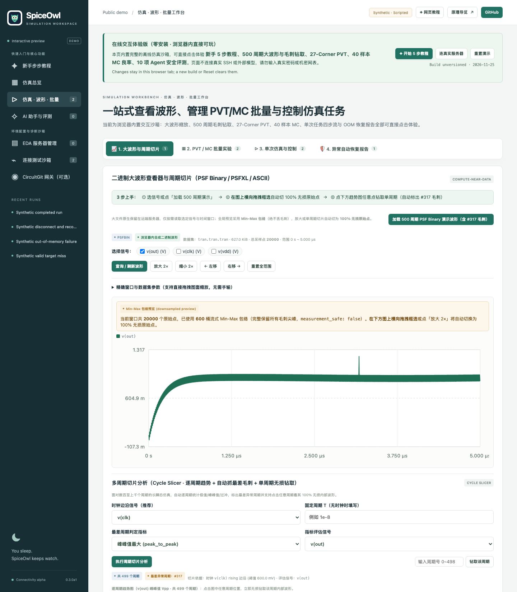

<p align="center">
  
</p>

<h1 align="center">SpiceOwl · 仿真夜枭</h1>

<p align="center"><strong>你去休息，仿真我盯。</strong></p>
<p align="center">专为模拟 / 混合信号 IC 工程师打造的开源、Web 优先 AI Agent 仿真工作台。</p>
<p align="center"><a href="README.md">English</a> · 简体中文 · <a href="docs/direct-execution.md">直连执行与有界恢复</a> · <a href="docs/cross-platform.md">跨平台与自动测试</a> · <a href="docs/architecture.md">架构设计</a> · <a href="docs/roadmap.md">开发路线</a> · <a href="CONTRIBUTING.md">参与贡献</a></p>

<p align="center"><a href="https://spiceowl-dev.github.io/spiceowl/"><strong>打开 SpiceOwl 正式网页工作台</strong></a> · <a href="https://spiceowl-dev.github.io/spiceowl/workflow.html#so-videos"><strong>观看完整宣传片与 10 节实录</strong></a> · <a href="https://spiceowl-dev.github.io/spiceowl/workflow.html">产品展示页</a> · <a href="https://github.com/spiceowl-dev/spiceowl/releases/tag/demo-videos-v1">下载高清视频</a></p>

SpiceOwl 原生支持 **macOS、Linux 与 Windows**，采用 **Web 优先** 架构：**[`https://spiceowl-dev.github.io/spiceowl/`](https://spiceowl-dev.github.io/spiceowl/) 就是唯一的正式产品界面**，日常无需命令行或切换第二套本地网址。需要连接自己的 SSH/LSF/Slurm EDA 集群或本机 Codex Agent 时，只需双击安装一次无界面 **SpiceOwl Connector**（macOS 双击 `Install SpiceOwl Connector.command`，Windows 双击 `Install SpiceOwl Connector.bat`，免管理员权限注册 `spiceowl://` 协议并在 `127.0.0.1:8765` 静默待命），从此全部操作在浏览器内一键直连完成。

## 产品宣传片与 10 节全流程实战视频

> **观看带自然 AI 语音解说 + 原创环境配乐的完整产品宣传片（`10:45`，1600×812 HD），或前往[产品展示页视频剧场](https://spiceowl-dev.github.io/spiceowl/workflow.html#so-videos)按章节直接在线播放。**

<p align="center">
  <a href="https://spiceowl-dev.github.io/spiceowl/workflow.html#so-videos">
    
  </a>
</p>

<p align="center">
  <a href="https://spiceowl-dev.github.io/spiceowl/workflow.html#so-videos"><strong>▶ 在线观看完整宣传片 (10:45)</strong></a> ·
  <a href="https://github.com/spiceowl-dev/spiceowl/releases/download/demo-videos-v1/SpiceOwl_Launch_Film.mp4">直链下载 MP4 (59.8 MB)</a> ·
  <a href="https://github.com/spiceowl-dev/spiceowl/releases/tag/demo-videos-v1">查看全部 11 个高清视频</a>
</p>

| 章节 | 主题 | 时长 | 核心演示内容 | 观看 |
| :---: | --- | :---: | --- | --- |
| **01** | **30 秒零配置连接本机** | `0:34` | 双击安装一次无界面 `spiceowl://` Connector，浏览器 `127.0.0.1` 静默配对并打通本机 Agent | [在线播放](https://spiceowl-dev.github.io/spiceowl/workflow.html#video-01) · [MP4](https://github.com/spiceowl-dev/spiceowl/releases/download/demo-videos-v1/01_initial_connect.mp4) |
| **02** | **1 分钟纳管整套 EDA 集群** | `0:41` | 可视化 SSH 向导自动识别旧版跳板机 RSA 兼容，新增节点自动复用跳板机与账号，5 项全绿校验 | [在线播放](https://spiceowl-dev.github.io/spiceowl/workflow.html#video-02) · [MP4](https://github.com/spiceowl-dev/spiceowl/releases/download/demo-videos-v1/02_connect_servers.mp4) |
| **03** | **集群算力与 FlexLM License 洞察** | `0:40` | 512 核 CPU/内存/活跃 EDA 进程 + 多台 FlexLM 许可席位一屏透明，自动推荐最空闲节点给 AI | [在线播放](https://spiceowl-dev.github.io/spiceowl/workflow.html#video-03) · [MP4](https://github.com/spiceowl-dev/spiceowl/releases/download/demo-videos-v1/03_resource_monitor.mp4) |
| **04a** | **一句话让 AI 打开远端电路** | `0:45` | 脱离卡顿 Virtuoso GUI，满血全权模式模糊检索 `cds.lib` 并隔离导出网表与 Maestro，零占 ADE 许可 | [在线播放](https://spiceowl-dev.github.io/spiceowl/workflow.html#video-04a) · [MP4](https://github.com/spiceowl-dev/spiceowl/releases/download/demo-videos-v1/04a_agent_open_workspace.mp4) |
| **04b** | **网页只读远程 Library Manager** | `0:42` | 浏览器直接浏览远端目录与 `cds.lib`，自动标注 `schematic/maestro`，隔离 `Cadence si` + 只读 SKILL 导出 | [在线播放](https://spiceowl-dev.github.io/spiceowl/workflow.html#video-04b) · [MP4](https://github.com/spiceowl-dev/spiceowl/releases/download/demo-videos-v1/04b_manual_library_manager.mp4) |
| **05** | **批量温度扫描与自动出报闭环** | `0:51` | 一句话提交三温度扫描，自动分组派发、每 4 秒自动巡检、收齐波形并推送 AI 自动生成交互报告 | [在线播放](https://spiceowl-dev.github.io/spiceowl/workflow.html#video-05) · [MP4](https://github.com/spiceowl-dev/spiceowl/releases/download/demo-videos-v1/05_submit_sim_and_report.mp4) |
| **06** | **交互式仿真报告与 102 KB 离线分享** | `0:43` | 单点矢量波形报告 + 多温度「TB 综合报告」横向对比，一键导出 102 KB 独立离线 HTML 随时评审 | [在线播放](https://spiceowl-dev.github.io/spiceowl/workflow.html#video-06) · [MP4](https://github.com/spiceowl-dev/spiceowl/releases/download/demo-videos-v1/06_simulation_reports.mp4) |
| **07** | **自由创作定制温度特性曲线** | `0:57` | 一句话让 AI 现写统一 PSF 测量脚本，提取并绘制增益、±0.1% 建立时间、10–90% 上升时间与 VDD 功耗曲线 | [在线播放](https://spiceowl-dev.github.io/spiceowl/workflow.html#video-07) · [MP4](https://github.com/spiceowl-dev/spiceowl/releases/download/demo-videos-v1/07_custom_ai_report.mp4) |
| **08** | **自然语言编程夜间值守脚本** | `0:58` | 透明可控的 `night_watch.py` 规则引擎，自然语言修改策略边界，强制隔离沙箱 Dry-Run 验真后生效 | [在线播放](https://spiceowl-dev.github.io/spiceowl/workflow.html#video-08) · [MP4](https://github.com/spiceowl-dev/spiceowl/releases/download/demo-videos-v1/08_agent_edit_night_watch.mp4) |
| **09** | **压轴实战：守红线 & 沉淀永久规则** | `3:25` | 遇未知 `STB` 报错坚决拒改原始网表并完整留证；一句授权后沉淀为永久 Python 规则自动恢复出报，跳过项诚实标 `Skipped / Unverified` | [在线播放](https://spiceowl-dev.github.io/spiceowl/workflow.html#video-09) · [MP4](https://github.com/spiceowl-dev/spiceowl/releases/download/demo-videos-v1/09_night_watch_new_case.mp4) |

## 最新核心能力

- **Code-First 可进化夜间值守（`night_watch.py`）、沙箱 Dry-Run 与一键启停**：用透明可读的本地 Python 规则引擎（`src/spiceowl/night_watch_script.py`）取代黑盒勾选框。顶栏支持一键「▶ 开启 / ⏸ 暂停夜间值守」；支持自然语言让 Agent 调整排队超时、OOM 内存上限、主机迁移策略或新增自定义排障规则（搭配单次调用 `update_watch_config` 与 `spiceowl-quick-ops` / `spiceowl-night-watch` Skill 极速响应），所有修改强制先经**独立沙箱 Dry-Run 验真**后生效。遇到触及电路定义边界的未知报错时，严守科学红线拒改网表与验收标准并完整留证；获工程师一句授权即可沉淀为永久规则，后续自动恢复有效波形并诚实标注跳过项为 `Skipped / Unverified`。
- **双模式交互式 HTML 报告引擎（快速报告 & 自由创作）、TB 综合横评与 102 KB 离线导出**：仿真结束后 4 秒自动巡检收尾并自动推送给 AI 出报（`src/spiceowl/report_builder.py`、`spiceowl-sim-report-fast`、`spiceowl-sim-report`）。**快速模式**秒出带矢量波形、KPI 卡片与五维诊断的交互网页，并自动归档至多工况「TB 综合报告」，支持一键导出仅约 **102 KB 的单文件独立离线 HTML**（同事和导师双击即可悬停读数与开关曲线）；**自由创作模式**允许用大白话要求现算原始 PSF 并定制任意工程趋势曲线（如增益、建立时间、上升时间、VDD 功耗随温度变化）并自动回写报告库。
- **双路径零 Virtuoso 打开远端电路（AI 模糊搜库 + 网页只读 Library Manager）**：无需启动卡顿的 Virtuoso GUI，也**零占用昂贵的 ADE 交互许可**。既可一句话让 AI 跨目录模糊检索远端 `cds.lib` 并隔离导出网表与 Maestro 配置，也可直接在网页**只读远程 Library Manager** 中点选浏览远端目录（自动标注 `schematic` / `maestro`，隔离调用 `Cadence si` + 只读 SKILL 导出，绝不修改原始设计库），同时兼容本地 `.scs / .sp / .cir` 网表导入。
- **可视化 SSH 集群向导与实时 FlexLM SPICE License 监控**：告别手写 `~/.ssh/config` 与反复输密码，1 分钟完成多机纳管——自动复用 `ProxyJump` 跳板机与账号、自动识别旧版 OpenSSH 并启用 `ssh-rsa` 兼容、仅本机托管免密密钥（密码绝不落盘）并完成 5 项全绿连通校验（`onboarding_wizard.py`）。服务器资源页并行探测多台计算节点的 CPU、内存、磁盘、活跃 EDA 进程及多台 **FlexLM 许可服务**（`Spectre` / `Spectre X` / `ADE Assembler` / `ADE Explorer` / `Spectre GXL`），自动向 AI 推荐最空闲主机（`host_activity.py`）。
- **精简 4 页统一工作台、三级 Codex 权限模式与 5 大内置 Skill**：将未连接预览与已连接工作台统一为 4 个核心页面（`首页与连接` / `服务器资源` / `仿真工作台` / `历史任务与报告`），提供 **安全托管 / 满血受控 / 满血全权** 三级权限与实时终端流式输出，内置 5 大 Skill（`spiceowl-quick-ops`、`spiceowl-sim-submit`、`spiceowl-sim-report-fast`、`spiceowl-sim-report`、`spiceowl-night-watch`），原生兼容远端 `csh / tcsh`、Python 2.7 与自动发现 Spectre。
- **二进制大波形原位解析（PSF Binary / PSFXL）、无损模拟量测（M3）与 PVT / Monte Carlo 批量管理**（[直连执行指南](docs/direct-execution.md)）：无需下载数 GB 原始波形，支持远端 Linux 原位 `seek()` 流式读取，全局 Min-Max 包络绝不丢毛刺、拖拽缩放自动切 100% 原始无损点并内置 **Cycle Slicer** 异常周期钻取；内置通用无损模拟量测配方库与保守良率 / `Cpk` 统计。
- **原生跨平台（macOS / Linux / Windows）与 17 项全功能 CI 矩阵**（[跨平台与测试指南](docs/cross-platform.md)）：通过 [`src/spiceowl/_platform.py`](src/spiceowl/_platform.py) 原生支持三端（Windows 无需 WSL），每次提交自动运行 Ubuntu / macOS / Windows 单元测试及 Chromium Playwright 桌面端与 390px 移动端 E2E 回归（[`.github/workflows/tests.yml`](.github/workflows/tests.yml)）。

## 产品展示

**[打开 SpiceOwl 产品理念与九节全流程导览页](https://spiceowl-dev.github.io/spiceowl/workflow.html)**

- 开篇凝练呈现 SpiceOwl 端到端协作架构，并内置可按需展开的 **10:45 完整产品宣传片** 快捷播放条。
- 围绕全部 **9 节核心实录** 采用**左文右视频**排版：左侧拆解功能边界、设计理念与工程思想，右侧以真实集群录像直观演示具体操作方法（视频按需流式加载，打开页面零额外流量消耗）。
- 第 04 节内置双路径标签无缝切换 **04a（AI 对话模糊搜库）** 与 **04b（网页只读 Library Manager）**，并以第 09 节“未知故障严守科学红线 + 一句话沉淀永久规则”收官。

**可选设计工作台集成：** [CircuitGit · AI-native 本地电路设计与 Git 版本管理](https://circuitgit-dev.github.io/CircuitGit/workflow/index.html)。作为子模块嵌入时，SpiceOwl 直接复用其原有 Codex 窗口，绝不启动第二个平行 Agent。

## 体验工作台

> **零门槛体验：** 直接打开 [`https://spiceowl-dev.github.io/spiceowl/`](https://spiceowl-dev.github.io/spiceowl/) 即可浏览统一 4 页工作台、合成仿真轨迹与脚本化诊断；点击顶栏「**连接本机**」并完成 30 秒一次性无界面 Connector 安装后，即可直接驱动你自己的 SSH/LSF/Slurm 集群与本机 Codex Agent。Pages 自动发布流程见 [GitHub Pages 指南](https://github.com/spiceowl-dev/spiceowl/blob/main/docs/github-pages.md)。

**双模式 Agent：** 独立 SpiceOwl 拥有显式连接的 Codex App-Server 对话与三级权限门禁；嵌入 CircuitGit 时只导出工具，复用宿主原对话窗口。详见[双模式 Agent 指南](docs/dual-mode-agent.md)与[集成约定](docs/circuitgit-integration.md)。

更多专项技术文档：[原生直连执行与有界恢复](docs/direct-execution.md) · [从零接入仿真](docs/onboarding-discovery.md) · [引导式接入](docs/smart-onboarding.md) · [缓存作用域选择 SDK](docs/pdk-scope-selection.md) · [Agent 编写测试平台](docs/agent-testbench.md) · [单器件 PDK LUT](docs/pdk-lut.md) · [ADC 分析工具（`pip install '.[adctools]'`）](docs/adctools.md) · [原生 AC/DC 量测](docs/ac-dc-results.md) · [Agent 可复现流程](docs/agent-reproducibility.md)。


*统一网页工作台总览：清晰侧边栏导航、实时任务状态卡与新手引导入口。*



*500 周期 PSF Binary Min-Max 包络预览、缩放自动切无损与 Cycle Slicer `#317` 异常周期定位。*

## 为什么做 SpiceOwl

下班前点开一批仿真，第二天回来才发现 SSH 断了、任务 OOM、License 排队卡死，或者仿真虽跑完却漏存关键信号、暗藏 SOA 超限——就算全部跑通，也还要花半小时截几十张波形拼 PPT 才能开评审会。

SpiceOwl 把这条脆弱的手工链路变成**可审计、会自己盯盘的工程闭环**：跑了什么、在哪台机子和什么许可/PDK 状态下跑的、出了什么错、触发了哪条有界恢复规则（绝不偷改电路意图），以及一份打开即可评审的交互式工程报告。

## 当前能力状态

| 能力模块 | 目标行为 | 当前状态 |
| --- | --- | --- |
| **Web 入口与本机直连** | `github.io` 唯一正式界面 + 后台静默 Connector | 已落地（`127.0.0.1:8765`，macOS/Windows/Linux 免管理员 `spiceowl://` 安装器） |
| **SSH 集群与许可洞察** | 可视化多级跳板配置 + 实时算力与 FlexLM 席位监控 | 已落地（跳板机与账号复用、旧版 RSA 自动兼容、5 项校验、CPU/RAM/EDA 与 FlexLM 池） |
| **零 Virtuoso 接入** | 脱离卡顿 GUI 与 ADE 席位打开远端设计库 | 已落地（AI 模糊搜库导出 + 网页只读远程 Library Manager + 本地网表导入） |
| **直连提交与自动巡检** | 原生 `ssh_direct / lsf / slurm` + 可选 CircuitGit Runner | 已落地（SHA-256 冻结、1-SSH 极速提交 Skill、4 秒自动巡检、断连占位防重发、PVT/MC 批量） |
| **交互报告与无损分析** | 快速交互报告 + 自由创作 PSF 曲线 + 轻量离线分享 | 已落地（快速/自由双模式、TB 综合横评、~102 KB 离线 HTML、无损 M3 量测、PSF Binary/Cycle Slicer、ADCTools） |
| **可进化夜间值守** | 透明 Python 规则引擎 + 沙箱 Dry-Run 验真 + 严守红线 | 已落地（`night_watch.py`、一键启停、Dry-Run Studio、M4 许可/OOM 有界恢复与人工授权沉淀自定义规则；求解器二进制 checkpoint 续算留作后续路线） |
| **五维科学结论** | 严格区分执行、测量有效性、性能达标、SOA 与依赖来源 | 已落地（五维独立呈现，有效指标失败与跳过项均诚实保留） |

### 一份晨间报告必须分开回答三个问题

| 问题 | 示例结论 |
| --- | --- |
| 仿真器运行完了吗？ | 执行完成 |
| 这次测量符合实验要求吗？ | 输入一致，信号齐全，测量窗口有效 |
| 电路性能达标了吗？ | 未达标：建立时间超过目标 |

测量有效但性能不达标，是有价值的实验证据。自动恢复绝不能通过擅自放宽条件或修改网表，把失败“修”成绿色通过。

## 设计原则

- **运行独立于界面。** 任务由远端调度器与求解进程管理，关闭浏览器绝不会中断仿真。
- **允许状态未知。** 连接中断不等于仿真失败；重提之前必须按原 `submission_key` 对账。
- **透明代码值守，Agent 负责排查与演进规则。** 常规恢复由可读的 `night_watch.py` 确定性执行；Agent 每次改写规则都必须先过隔离沙箱 Dry-Run。
- **每次尝试皆可追溯。** 完整保存 SHA-256 冻结输入、工具版本、执行回执、恢复差异及诚实的 `Skipped / Unverified` 标注。
- **科学红线不可逾越。** 任何涉及网表、容差、激励、Corner、随机种子或验收标准的修改都必须经过明确的人工授权。

## 仓库目录

```text
spiceowl/
├── README.md                  # 英文项目介绍与视频目录
├── README.zh-CN.md            # 中文项目介绍与视频目录
├── skills/                    # 5 大内置 Agent Skill（quick-ops / sim-submit / report-fast / report / night-watch）
├── docs/                      # 架构、直连执行、实验约定、路线和设计决策
├── assets/brand/              # 可编辑图标与头像导出文件
├── examples/                  # 原创反相器与配置草案示例
├── scripts/                   # 环境安装、Pages 构建、链接检查与跨平台全量测试脚本
├── src/spiceowl/              # 可安装的 Python 软件包
│   ├── _platform.py           # 统一的 macOS / Linux / Windows 跨平台兼容层
│   ├── connector.py           # 免管理员 spiceowl:// Connector 安装器与本地桥接
│   ├── direct.py              # 独立 SSH/LSF/Slurm 直连执行与 4 秒自动巡检监管
│   ├── batch.py               # PVT / Corner / Monte Carlo 批量派发与保守良率统计
│   ├── hosts.py               # 主机池登记与 SSH 连通探测
│   ├── host_activity.py       # 多机 CPU/内存/活跃 EDA 进程与 FlexLM 许可池并行探测
│   ├── onboarding_wizard.py   # 可视化 SSH 配置向导（ProxyJump 复用与旧版 RSA 兼容）
│   ├── report_builder.py      # 快速/自由双模式交互式 HTML 与矢量 SVG 报告引擎
│   ├── night_watch_script.py  # Code-first night_watch.py 规则引擎、AST 改配与沙箱 Dry-Run
│   ├── watch_handoff.py       # 夜间值守事件流与 Agent 交接策略层
│   ├── skills.py              # 内置 Skill 加载与提示词注入
│   ├── standalone_agent.py    # 三级 Codex 权限通道与工具分发器
│   ├── simulation_tools.py    # 统一仿真、选库与网页 UI 同步工具
│   ├── experiments/           # 源码抽取、固定配方与无损 M3 模拟量测引擎
│   ├── onboarding/            # 远程只读库管理、TB 校验、PDK 发现与 SQLite LUT
│   ├── adctools/              # 可选 ADC 算法及固定版本 ADCToolbox 适配
│   ├── monitoring/            # 持久化观测与重启安全的增量日志流
│   ├── recovery/              # M4 有界自动恢复引擎与可搜索 JSON/Markdown 报告
│   ├── integrations/          # CircuitGit 客户端/资源池、Spectre 诊断与 PSF 解析
│   ├── domain/                # 实验、尝试、回执与事件模型
│   ├── adapters/              # 执行环境（SSH / Direct / LSF / Slurm / Mock）与仿真器适配
│   ├── storage/               # 持久化记录与产物引用
│   ├── read_api.py            # 供 CircuitGit 直接调用的只读 SDK 视图
│   ├── cli/                   # 本地命令入口
│   └── web/                   # 本地 API、统一网页工作台与展示页资源
└── tests/                     # 离线 Python、Node 与 Playwright 浏览器端到端测试套件
```

## 快速开始

### 推荐方式：直接打开网页工作台 + 一键安装本机 Connector

1. 打开 [`https://spiceowl-dev.github.io/spiceowl/`](https://spiceowl-dev.github.io/spiceowl/)。
2. 点击右上角「**连接本机**」，按 30 秒向导双击安装一次无界面 Connector（macOS `.command` / Windows `.bat` / Linux 脚本）。
3. 在「服务器资源」使用**可视化 SSH 向导**连上你的 EDA 集群，随后通过 AI 对话或**网页只读 Library Manager** 打开电路即可开跑。

### 开发者 / 本地源码运行

克隆仓库后执行 `python3 scripts/setup_dev.py` 即可自动安装固定版本的完整开发环境，随后运行 `.venv/bin/spiceowl serve --demo`（详见[开发者环境说明](docs/developer-setup.md)）；或在 macOS / Linux / Windows 使用 Python 3.11+ 直接安装（见[跨平台指南](docs/cross-platform.md)）：

```bash
# macOS / Linux
git clone https://github.com/spiceowl-dev/spiceowl.git
cd spiceowl
python3 -m venv .venv
.venv/bin/python -m pip install .
.venv/bin/spiceowl serve --demo
```

```powershell
# Windows (PowerShell)
git clone https://github.com/spiceowl-dev/spiceowl.git
cd spiceowl
py -3 -m venv .venv
.venv\Scripts\python.exe -m pip install .
.venv\Scripts\spiceowl.exe serve --demo
```

一键运行跨平台全量自动化测试：

```bash
# macOS / Linux
.venv/bin/python scripts/run_full_tests.py

# Windows (PowerShell)
.venv\Scripts\python.exe scripts\run_full_tests.py
```

### CLI 原生直连执行（可选）

```bash
# 冻结输入并开启 M4 有界自动恢复（许可证退避重提 + OOM 内存扩配/主机迁移）
spiceowl direct prepare --run-key amp-tran-01 --netlist ./amp.scs --host lab-sim --backend slurm \
  --enable-recovery --max-recovery-attempts 2 --max-memory-gb 32 --allow-host-relocation
spiceowl direct stage amp-tran-01
spiceowl direct launch amp-tran-01
spiceowl direct watch amp-tran-01 --allow-collect --auto-resume-watch

# 搜索持久化恢复报告
spiceowl direct recovery-reports --query oom
spiceowl direct recovery-report amp-tran-01 --markdown
```

可选 CircuitGit 网关模式（`spiceowl serve --live-client-config /absolute/private/live-client.json`）与开发者反相器烟雾测试脚本（[`scripts/run_inverter_smoke.py`](scripts/run_inverter_smoke.py)）详见[独立仿真指南](docs/standalone-runtime.md)、[原生直连执行指南](docs/direct-execution.md)与[反相器示例说明](examples/inverter/README.md)。

## 参与贡献

欢迎模拟设计、CAD 与科学计算方向的贡献者。脱敏的 `night_watch.py` 故障恢复案例、通用无损量测配方以及故障注入测试都是极佳起点。

共享数据前请阅读 [CONTRIBUTING.md](CONTRIBUTING.md)；漏洞报告和敏感材料处理见 [SECURITY.md](SECURITY.md)；背景参考见 [docs/references.md](docs/references.md)。

## 许可证

采用 [MIT](LICENSE) 许可证。本项目不分发 Cadence 工具、PDK 或第三方商业组件；未来引入的第三方代码保留其适用许可证及声明。
