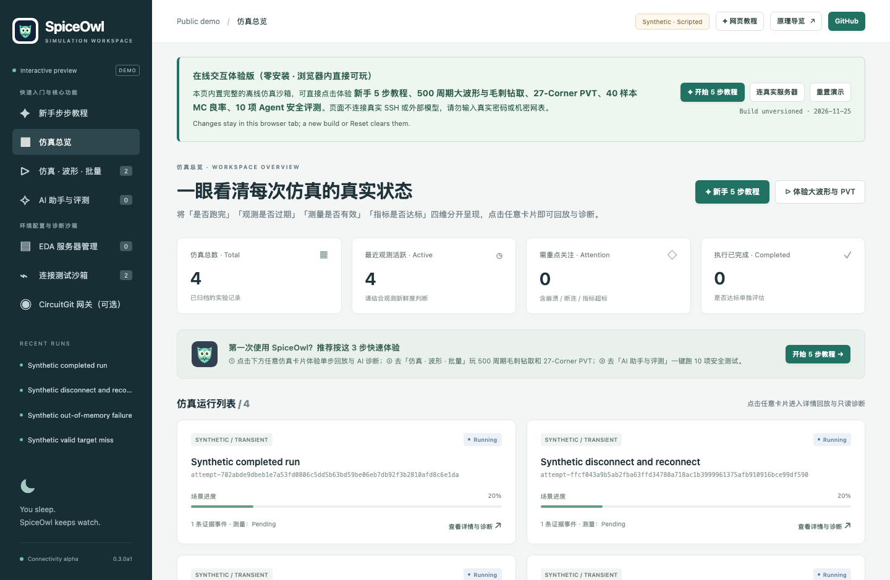

<p align="center">
  
</p>

<h1 align="center">SpiceOwl · 仿真夜枭</h1>

<p align="center"><strong>你去休息，仿真我盯。</strong></p>
<p align="center">面向长时间电路仿真的开源 Agent 控制台。</p>
<p align="center"><a href="README.md">English</a> · 简体中文 · <a href="docs/architecture.md">架构设计</a> · <a href="docs/roadmap.md">开发路线</a> · <a href="CONTRIBUTING.md">参与贡献</a></p>

> **早期 Alpha：服务器池、原生 Agent 问答与开发者反相器 smoke 测试。** 可以比较有范围限制的 SSH 资源观测、生成独立网表或 Virtuoso 来源的执行计划，并向已安装的 Codex runtime 发送简短问题。网页中的仿真任务和任务诊断仍使用合成数据。独立、显式调用的[开发者脚本](examples/inverter/README.md)可在具有许可证的 Spectre 环境执行原创 MOS1 反相器；网页/CLI 通用仿真提交和无人值守监控待实现。可选 MCP 工具读取已保存的记录。见[控制台指南](docs/local-console.md)、[服务器池指南](docs/server-pool.md)和[原生问答指南](docs/native-agent.md)。



*实际原型界面，使用项目编写的合成观测数据。*

## 为什么做 SpiceOwl

晚上启动仿真，第二天回来才发现连接断了、任务内存不足，或者仿真已经结束，却没有保存测量需要的信号。

SpiceOwl 希望把这些情况变成一份清晰的实验记录：执行了什么、哪里出现异常、采取过哪些恢复动作，以及结果能否回答原本的实验问题。

第一阶段面向 **使用 Virtuoso / Spectre 的模拟与混合信号研究**，从一个经过验证的 Linux 执行环境开始。公共开发使用模拟执行器和合成测试数据，让没有商业仿真器或 PDK 的贡献者也能参与。

## 计划实现的能力

| 能力 | 目标行为 | 当前状态 |
| --- | --- | --- |
| 接入 | 管理用户自带的 Agent 与模型 API，明确登录、能力和用量边界 | 已实现原生 Codex 问答、模拟 Agent/API 管理、MCP 查询及 SSH 主机/资源检查 |
| 观察 | 跟踪任务身份、仿真进度、日志、内存和磁盘使用 | 已有真实主机快照和开发者 smoke 回执；网页任务仍为合成场景 |
| 重连 | 在客户端或控制器中断后核对并找回原任务 | 已实现本地记录恢复和原 smoke 任务状态查询；通用仿真任务重连待实现 |
| 验收 | 检查输入、必需信号、测量窗口和结果完整性 | 已实现验收汇总和反相器专用波形检查；通用波形验证器待实现 |
| 恢复 | 对支持的故障执行有次数、资源边界且可追溯的恢复策略 | 仅提供建议性策略；不执行操作 |
| 诊断 | 由可选 Agent 解释证据并提出处理建议 | 已实现离线模拟诊断 |
| 报告 | 分别呈现执行结果、测量有效性和电路性能 | 已有网页合成报告和独立反相器 smoke 报告 |

### 一份报告需要区分三个问题

| 问题 | 示例结论 |
| --- | --- |
| 仿真器运行完了吗？ | 执行完成 |
| 这次测量符合实验要求吗？ | 输入一致，信号齐全，测量窗口有效 |
| 电路性能达标了吗？ | 未达标：建立时间超过目标 |

测量有效但性能不达标，是需要保留的实验结果。恢复机制不能通过改变实验条件，把失败“修”成成功。

报告还会单独标明观测是否新鲜，避免把上次记录的“运行中”误认为当前状态。

## 设计原则

- **运行独立于界面。** 任务由远端执行服务或调度器管理，浏览器和 Agent 对话不拥有任务生命周期。
- **允许状态未知。** 连接丢失不等于仿真失败；再次提交前必须先核对原任务。
- **规则负责值守，Agent 负责调查。** 常规监控和已知恢复策略不依赖 LLM；Agent 提交结构化建议，由策略层判断是否执行。
- **每次尝试都可追溯。** 保留实际输入、工具身份、提交回执、异常证据，以及各次尝试之间的变化。
- **恢复保持实验含义。** 修改容差、激励、corner、随机种子或测量定义，必须符合明确策略，或形成经过审核的新实验。
- **按后端能力恢复。** 控制器重启、任务重连、求解器 checkpoint 续算是三种不同能力。

## 仓库目录

```text
spiceowl/
├── README.md                  # 英文项目介绍
├── README.zh-CN.md            # 中文项目介绍
├── docs/                      # 架构、实验约定、路线和设计决策
├── assets/brand/              # 可编辑图标与头像导出文件
├── examples/                  # 原创反相器与配置草案示例
├── scripts/                   # 显式调用的开发者反相器 smoke 与结果工具
├── src/spiceowl/              # 可安装的 Python 软件包
│   ├── domain/                # 实验、尝试、回执与事件模型
│   ├── adapters/              # 执行环境与仿真器适配
│   ├── monitoring/            # 状态观察与故障分类
│   ├── validation/            # 输入和测量验收
│   ├── recovery/              # 恢复策略与动作提案
│   ├── storage/               # 持久化记录与产物引用
│   ├── agent/                 # 连接、会话与可选诊断
│   ├── mcp/                   # 供现有 Agent 使用的可选只读工具
│   ├── scheduling/            # 资源选址与仿真来源计划
│   ├── cli/                   # 本地命令入口
│   └── web/                   # 本地 API 与随包网页资源
└── tests/                     # 离线测试与合成案例
```

软件包目前包含模拟 AI 连接、SQLite 控制器、合成回放、验收与策略函数、私有主机配置、有限 SSH 检查、可选 MCP 查询、CLI 和网页资源。[本地控制台指南](docs/local-console.md)区分已实现能力与后续任务监控；[架构文档](docs/architecture.md)和[实验约定](docs/run-contract.md)说明模块职责与可信实验的要求。

当前切片加入 **服务器池、仿真来源计划和原生问答**，接口见 [P0.3 约定](docs/contracts/p03-pool-agent.md)；[P0.2 约定](docs/contracts/p02-connectivity.md)记录 SSH/MCP 基础。更广的[整合实施方案](docs/design/integration-plan.md)还计划加入独立 API-key 路线与 ACP。[三个专题设计](docs/design/README.md)通过[共享接口边界](docs/contracts/interface-boundaries.md)对齐。

## 从哪里开始

在 macOS 或 Linux 上使用 Python 3.11 及以上版本：

```bash
git clone https://github.com/joshuazeng713/spiceowl.git
cd spiceowl
python3 -m venv .venv
.venv/bin/python -m pip install .
.venv/bin/spiceowl serve --demo
```

打开命令打印的本地网址，即可管理模拟连接、查看合成任务、推进观测并请求演示诊断。不需要模型、仿真器、Node.js 或凭据。重复使用 `--demo` 会保留已有历史；CLI、持久化和测试方式见[指南](docs/local-console.md)。

真实连接可在网页 **Simulation hosts → Add host** 中填写，或使用 `spiceowl hosts add --file PROFILE.json` 导入操作者编写的私有配置。登记只保存本地配置；**Check connection** 才显式检查所选主机。OpenSSH 复用已有别名和跳板配置。[主机接入指南](docs/host-onboarding.md)说明配置、重复保存及信任、认证、网络和资源过期的不同状态。版本查询不代表许可证可用、任务正在运行或仿真结果有效。

若要让 Codex 等 MCP 客户端读取记录，安装 `.[mcp]`，并将客户端配置为运行 `spiceowl --data-dir ABSOLUTE_STATE_DIR mcp`。服务使用官方 Python MCP SDK，读取同一本地数据库，但不接管控制器，也不能启动仿真或读取任意路径。配置格式、命令和验证边界见[真实连接指南](docs/real-connections.md)。

多节点场景可在 **Simulation hosts → Import pool** 中预览明确的主机名列表，并复用已有连接模板登记，也可使用 `hosts import-pool`。选择最多 32 台，执行 **Check selected hosts**；CLI 对应 `hosts scan --hosts HOST_ID ...`。网页在同一批选中主机中评估所需 CPU 和内存。未知或过期节点不参加选址；算法保留资源余量，但推荐不代表预留。独立网表计划为新任务选择候选节点，Virtuoso 管理的任务计划保留原主机和 native run 映射。

真实问答使用 `agents add --file PROFILE.json` 注册私有 runtime 配置，再打开 **Agent chat**。它复用 runtime 现有的服务提供商和认证配置，可能是订阅，也可能是另外配置的 API 路由。请求有持久化标识，不自动切换提供商，也不提供仿真操作工具。见[原生问答指南](docs/native-agent.md)。

## 开发者反相器 smoke 测试

源码仓库中的 [run_inverter_smoke.py](scripts/run_inverter_smoke.py) 为[原创教学 MOS1 反相器](examples/inverter/README.md)提供显式的 `prepare → stage → launch → status → collect` 流程。它需要已登记且有使用授权的 Linux 主机，以及具有许可证的 Spectre、GNU `timeout` 和可运行的 Python 3.6+。将 `HOST_ID` 替换为已登记主机 ID，将 `PYTHON_ABSOLUTE_PATH` 替换为远端 Python 解释器的绝对路径。逐条运行，并检查每一步结果再继续：

```bash
PYTHONPATH=src .venv/bin/python scripts/run_inverter_smoke.py prepare --data-dir .spiceowl --hosts HOST_ID --run-key inverter-smoke-001 --remote-python PYTHON_ABSOLUTE_PATH
PYTHONPATH=src .venv/bin/python scripts/run_inverter_smoke.py stage --run-dir .spiceowl/smoke/inverter-smoke-001
PYTHONPATH=src .venv/bin/python scripts/run_inverter_smoke.py launch --run-dir .spiceowl/smoke/inverter-smoke-001
PYTHONPATH=src .venv/bin/python scripts/run_inverter_smoke.py status --run-dir .spiceowl/smoke/inverter-smoke-001
PYTHONPATH=src .venv/bin/python scripts/run_inverter_smoke.py collect --run-dir .spiceowl/smoke/inverter-smoke-001
```

如果远端启动环境需要显式许可证配置，在 **prepare** 命令末尾追加可选参数 `--license-env-json PRIVATE_LICENSE_JSON_PATH`。这个私有 JSON 对象只接受 `CDS_LIC_FILE` 和/或 `LM_LICENSE_FILE`，值会冻结在私有计划中并传入仿真器环境；已有环境配置正确时可以省略。版本检查成功并不能证明实际仿真许可证可用。JSON 格式见[示例说明](examples/inverter/README.md)，真实许可证配置不应进入公开源码或对外分享的回执。

`prepare` 会主动检查选定主机并在本地冻结源文件和验收规则，不预留资源或启动任务。`stage` 把冻结输入写入独立远端目录。`launch` 重新检查资源余量、验证远端身份和版本，并为这一次限时仿真取得唯一启动占位。如果提交结果不明，使用同一保存目录执行 `status`；不要另建 key 或盲目重新启动。确认任务终止后再 `collect`。收集过程核对哈希与完成证据，保存原生 PSF ASCII 和日志，并分别报告执行结果、测量有效性及教学反相器行为。可选 `collect --plots` 需要另行安装本地 matplotlib。

请将 `.spiceowl/smoke/` 保持为私有数据。原创教学模型不代表任何制造工艺，smoke 通过也不能证明 PDK 或无人值守恢复已得到验证。这个工具独立于产品的网页/CLI 执行计划和只读 MCP；这些产品接口仍不派发仿真。资源限制与固定验收标准见[示例说明](examples/inverter/README.md)。

SpiceOwl 还可通过有限的只读适配器连接 IC Workbench。使用 `ic register`、`ic sync`、`ic runs` 保留原任务 ID 并查看已保存的观测；三个可选 MCP 工具向 Agent 提供本地缓存查询。提交与审批继续由 IC Workbench 原流程负责，简化监督卡片嵌入其仿真面板。此接口不代表已实现持续监控或自动恢复。见 [IC Workbench 对接指南](docs/ic-workbench.md)。

## 参与贡献

欢迎模拟设计、CAD 和科学计算方向的贡献者。脱敏故障案例、测量验证器以及带故障注入测试的小功能，都是有价值的起点。

共享数据前请阅读 [CONTRIBUTING.md](CONTRIBUTING.md)。漏洞报告和敏感材料处理见 [SECURITY.md](SECURITY.md)。[参考资料](docs/references.md)列出候选组件和相关原始文档。核心运行时仅依赖 Python 标准库；可选 MCP 扩展固定了测试过的官方 SDK 版本。

## 许可证

沿用仓库选择的 [MIT](LICENSE) 许可证。项目不分发 Cadence 工具、PDK 或第三方组件；未来引入的第三方代码保留其适用许可证及声明。
