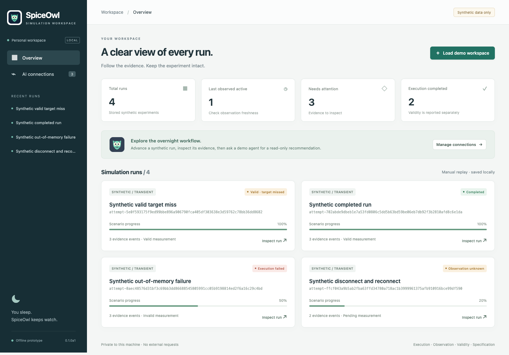

<p align="center">
  
</p>

<h1 align="center">SpiceOwl · 仿真夜枭</h1>

<p align="center"><strong>你去休息，仿真我盯。</strong></p>
<p align="center">面向长时间电路仿真的开源 Agent 控制台。</p>
<p align="center"><a href="README.md">English</a> · 简体中文 · <a href="docs/architecture.md">架构设计</a> · <a href="docs/roadmap.md">开发路线</a> · <a href="CONTRIBUTING.md">参与贡献</a></p>

> **早期 Alpha：本地控制台已加入只读连接能力。** CLI 与网页管理合成任务和诊断记录；显式 SSH 检查可以确认主机身份与仿真器版本，可选的 stdio MCP 服务让现有 Agent 查询本地记录。真实模型推理、仿真提交和无人值守监控仍待实现。见[控制台指南](docs/local-console.md)与[真实连接指南](docs/real-connections.md)。



*实际原型界面，使用项目编写的合成观测数据。*

## 为什么做 SpiceOwl

晚上启动仿真，第二天回来才发现连接断了、任务内存不足，或者仿真已经结束，却没有保存测量需要的信号。

SpiceOwl 希望把这些情况变成一份清晰的实验记录：执行了什么、哪里出现异常、采取过哪些恢复动作，以及结果能否回答原本的实验问题。

第一阶段面向 **使用 Virtuoso / Spectre 的模拟与混合信号研究**，从一个经过验证的 Linux 执行环境开始。公共开发使用模拟执行器和合成测试数据，让没有商业仿真器或 PDK 的贡献者也能参与。

## 计划实现的能力

| 能力 | 目标行为 | 当前状态 |
| --- | --- | --- |
| 接入 | 管理用户自带的 Agent 与模型 API，明确登录、能力和用量边界 | 已实现模拟 Agent/API 管理、只读 MCP 查询与 SSH 身份/版本检查 |
| 观察 | 跟踪任务身份、仿真进度、日志、内存和磁盘使用 | 已实现有限合成场景回放 |
| 重连 | 在客户端或控制器中断后核对并找回原任务 | 已实现本地记录恢复；真实任务待接入 |
| 验收 | 检查输入、必需信号、测量窗口和结果完整性 | 已实现验收汇总；波形验证器待实现 |
| 恢复 | 对支持的故障执行有次数、资源边界且可追溯的恢复策略 | 仅提供建议性策略；不执行操作 |
| 诊断 | 由可选 Agent 解释证据并提出处理建议 | 已实现离线模拟诊断 |
| 报告 | 分别呈现执行结果、测量有效性和电路性能 | 已实现四维合成报告 |

### 一份报告需要区分三个问题

| 问题 | 示例结论 |
| --- | --- |
| 仿真器运行完了吗？ | 执行完成 |
| 这次测量符合实验要求吗？ | 输入一致，信号齐全，测量窗口有效 |
| 电路性能达标了吗？ | 未达标：建立时间超过目标 |

测量有效但性能不达标，是需要保留的实验结果。恢复机制不能通过改变实验条件，把失败“修”成成功。

报告还会单独标明观测是否新鲜，避免把上次记录的“运行中”误认为当前状态。

## 设计原则

- **运行独立于界面。** 任务由远端执行服务或调度器管理，浏览器和 Agent 对话不拥有任务生命周期。
- **允许状态未知。** 连接丢失不等于仿真失败；再次提交前必须先核对原任务。
- **规则负责值守，Agent 负责调查。** 常规监控和已知恢复策略不依赖 LLM；Agent 提交结构化建议，由策略层判断是否执行。
- **每次尝试都可追溯。** 保留实际输入、工具身份、提交回执、异常证据，以及各次尝试之间的变化。
- **恢复保持实验含义。** 修改容差、激励、corner、随机种子或测量定义，必须符合明确策略，或形成经过审核的新实验。
- **按后端能力恢复。** 控制器重启、任务重连、求解器 checkpoint 续算是三种不同能力。

## 仓库目录

```text
spiceowl/
├── README.md                  # 英文项目介绍
├── README.zh-CN.md            # 中文项目介绍
├── docs/                      # 架构、实验约定、路线和设计决策
├── assets/brand/              # 可编辑图标与头像导出文件
├── examples/                  # 实验、连接和策略的非执行性示例
├── src/spiceowl/              # 可安装的 Python 软件包
│   ├── domain/                # 实验、尝试、回执与事件模型
│   ├── adapters/              # 执行环境与仿真器适配
│   ├── monitoring/            # 状态观察与故障分类
│   ├── validation/            # 输入和测量验收
│   ├── recovery/              # 恢复策略与动作提案
│   ├── storage/               # 持久化记录与产物引用
│   ├── agent/                 # 连接、会话与可选诊断
│   ├── mcp/                   # 供现有 Agent 使用的可选只读工具
│   ├── cli/                   # 本地命令入口
│   └── web/                   # 本地 API 与随包网页资源
└── tests/                     # 离线测试与合成案例
```

软件包目前包含模拟 AI 连接、SQLite 控制器、合成回放、验收与策略函数、私有主机配置、有限 SSH 检查、可选 MCP 查询、CLI 和网页资源。[本地控制台指南](docs/local-console.md)区分已实现能力与后续任务监控；[架构文档](docs/architecture.md)和[实验约定](docs/run-contract.md)说明模块职责与可信实验的要求。

当前接入切片是 **SSH 连接检查＋供现有 Agent 使用的 MCP 查询**，接口见 [P0.2 连接约定](docs/contracts/p02-connectivity.md)。更广的[整合实施方案](docs/design/integration-plan.md)还计划加入原生 Agent runtime、独立 API-key 路线与 ACP；这些仍是后续工作。[三个专题设计](docs/design/README.md)覆盖 AI 接入、仿真器接入和仿真诊断，并通过[共享接口边界](docs/contracts/interface-boundaries.md)对齐。

## 从哪里开始

在 macOS 或 Linux 上使用 Python 3.11 及以上版本：

```bash
git clone https://github.com/joshuazeng713/spiceowl.git
cd spiceowl
python3 -m venv .venv
.venv/bin/python -m pip install .
.venv/bin/spiceowl serve --demo
```

打开命令打印的本地网址，即可管理模拟连接、查看合成任务、推进观测并请求演示诊断。不需要模型、仿真器、Node.js 或凭据。重复使用 `--demo` 会保留已有历史；CLI、持久化和测试方式见[指南](docs/local-console.md)。

真实连接可使用 `spiceowl hosts add --file PROFILE.json` 导入操作者编写的私有主机配置，再执行 `spiceowl hosts probe HOST_ID`，或在网页 **Simulation hosts → Check connection** 中显式检查。OpenSSH 复用已有别名和跳板配置。版本查询不代表许可证可用、任务正在运行或仿真结果有效。

若要让 Codex 等 MCP 客户端读取记录，安装 `.[mcp]`，并将客户端配置为运行 `spiceowl --data-dir ABSOLUTE_STATE_DIR mcp`。服务使用官方 Python MCP SDK，读取同一本地数据库，但不接管控制器，也不能启动仿真或读取任意路径。配置格式、命令和验证边界见[真实连接指南](docs/real-connections.md)。

## 参与贡献

欢迎模拟设计、CAD 和科学计算方向的贡献者。脱敏故障案例、测量验证器以及带故障注入测试的小功能，都是有价值的起点。

共享数据前请阅读 [CONTRIBUTING.md](CONTRIBUTING.md)。漏洞报告和敏感材料处理见 [SECURITY.md](SECURITY.md)。[参考资料](docs/references.md)列出候选组件和相关原始文档。核心运行时仅依赖 Python 标准库；可选 MCP 扩展固定了测试过的官方 SDK 版本。

## 许可证

沿用仓库选择的 [MIT](LICENSE) 许可证。项目不分发 Cadence 工具、PDK 或第三方组件；未来引入的第三方代码保留其适用许可证及声明。
