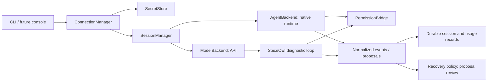

# AI connections and management

Status: implementation proposal, not a working integration. Checked **2026-11-13** (Asia/Shanghai). Scope: local, single-user P0 connection management. No login, credential inspection, installation, paid inference, or simulator access was performed for this design.

This proposal follows the [architecture](../architecture.md), [run contract](../run-contract.md), and [shared interface boundaries](../contracts/interface-boundaries.md). The [connection example](../../examples/connections.example.json) is synthetic and deliberately non-executable. All interfaces, module paths, commands, and acceptance tests below are proposed unless explicitly described as upstream behavior.

## Decision and first deliverable

Build two separate Python adapter families behind a small connection registry:

- **AgentBackend:** control an existing agent runtime, which owns its model loop, native tools, and provider conversation state. Start with an installed, official **Codex app-server over stdio**, using the user's native login on that same host. Restrict this first route to the documented local/open-source use case.
- **ModelBackend:** call an inference API while SpiceOwl owns diagnostic context, any tool loop, and local history. Start with **OpenAI's official Python SDK and an explicit API-key reference**, using Responses. A custom compatible endpoint is a separate, explicitly configured connection and dialect, not an automatic substitute.

The smallest runnable code slice is **P0.1: config validation + registry + FakeAgentBackend + FakeModelBackend + SQLite session/event storage + CLI list/inspect/probe + one synthetic diagnostic turn**. It must run offline, demonstrate distinct readiness states, survive restart, and reject an attempted permission escalation. P0.2 adds the two real paths behind the same contracts, initially tested against local fake peers. Only a separately authorized smoke test may mark a real model as inference-verified. P0.3 adds ACP through its official Python SDK.

Use LiteLLM only as a later optional ModelBackend when a second API provider justifies normalization. Reference T3 Code and AionUi for connection UX and lifecycle patterns; do not adopt their whole applications as SpiceOwl's runtime. Do not depend on deprecated AgentAPI. These choices are engineering recommendations based on the bounded evidence below, not upstream endorsement.

## Verified upstream evidence and adoption choices

Source labels link to original sources at the end of this document. Every source was checked on 2026-11-13. Moving `main` URLs are research evidence, not dependency pins; implementation must record exact release, source commit, schema hash, package hashes, and notices before adoption. No claim here establishes a particular user's account entitlement.

| Candidate | Observed upstream surface | SpiceOwl decision |
| --- | --- | --- |
| ACP + official Python SDK | ACP negotiates protocol version, capabilities, and authentication methods. The official `agent-client-protocol` distribution supplies generated models, asyncio transport, and stdio JSON-RPC helpers. SDK license: Apache-2.0. [A1][A2][A3] | Direct optional dependency in P0.3. Implement the **client** side; do not rewrite ACP framing or wrap every runtime speculatively. |
| Codex app-server | Official bidirectional conversation/control protocol, with initialization, threads, turns, streaming and approvals. Stdio uses JSONL; its wire messages omit the `jsonrpc` header. CLI-generated schemas correspond to the installed version. [O1] | First real AgentBackend. Own a narrow Python transport/adapter and use the official binary. Keep experimental fields off by default. |
| OpenAI Python SDK | Official sync/async API client; Responses is its primary inference API, with streaming support. Apache-2.0. [O6][O7] | First real ModelBackend. Use an optional package extra, explicit credentials, timeout, and retry configuration. |
| LiteLLM | Python normalization, streaming, Router retry/fallback, and an optional gateway; current docs also describe a leaner `litellm-core` distribution sharing the `litellm` imports. [L1] | Defer until multiple API providers are needed. Evaluate the lean SDK distribution first; no mandatory proxy, Redis, database, or enterprise service. |
| T3 Code | MIT application with provider setup and explicit connection selection. Its `effect-codex-app-server` package is private, uses TypeScript/Effect and generated protocol bindings; client source separates requests, notifications and server-request handlers. [T1][T2][T3] | Reference adapter separation, status UX and pending interactions. Do not treat a private TS workspace package as a stable Python dependency or copy its account-sharing implementation. |
| AionUi | Apache-2.0 Cowork application; README describes external ACP agents, while its package manifest shows an Electron application and ACP SDK dependency. [U1][U2][U3] | Reference external-agent setup and capability-driven UI. Do not import its desktop stack, bundled agent, automatic installs, or broad automation surface. |
| `coder/agentapi` | README explicitly says deprecated and no longer maintained; repository is archived. [D1] | Exclude from new dependencies. Do not build terminal-screen scraping around it. |

The source inspection was deliberately small: ACP interfaces/core, T3's client and package manifest, AionUi's manifest, and license files. It was not a security audit or compatibility test of either application. AionUi's advertised provider coverage does not prove native protocol support, authentication permission, or tested sandbox behavior for any particular adapter.

**License boundary:** LiteLLM's root license currently excludes `litellm/enterprise/` from MIT; the enterprise license text was found at `litellm/enterprise/LICENSE.md`. Older indexed paths under `enterprise/` differ. Enterprise production use has separate licensing requirements; enterprise docs identify additional gated features. Inspect the exact installed artifact rather than relying on the package's top-level MIT label. [L2][L3][L4] SpiceOwl remains MIT; retain dependency licenses/notices and modified-file notices where applicable. Code licensing and authorization to use a provider account are separate questions.

## Authentication routes and product boundaries

| Route | Who owns credentials and login | P0 behavior |
| --- | --- | --- |
| Codex native local login | Official runtime and its native credential store | User chooses an installed binary/profile. Obtain sanitized status through its documented account surface. Offer the native sign-in flow only on an explicit connect/login action. Never read or copy its credential files. |
| Sign in with ChatGPT (SIWC) | Registered application following OpenAI's official consent/token lifecycle | Preferred future application-owned onboarding. Separate auth strategy; do not approximate it by exporting native Codex tokens. Requires its own eligibility, consent, refresh, storage and UI work. |
| API key | User-owned API project/provider account; SpiceOwl resolves only a configured reference | One key reference per connection, explicitly bound to endpoint and auth scheme. Do not infer billing project or identity from a key string. |
| Native Claude Code | User authenticates directly into the unmodified Anthropic binary | Possible later native-runtime integration, subject to official terms and adapter verification. No Claude subscription-backed ModelBackend or SDK token import. |
| Custom compatible API | User selects the endpoint operator and provides that operator's credential reference | Separate endpoint, dialect, model selector and capability profile. Connection labels must identify the actual operator; compatibility does not confer OpenAI/Anthropic entitlement. |
| Generic ACP agent | Authentication methods come from the selected agent; authorization comes from its provider | Negotiate methods, then allow only reviewed flows. No generic OAuth-token collector. A wrapper's existence is not evidence of permission. |

OpenAI explicitly distinguishes existing local/open-source app-server authentication from commercial or hosted services and recommends migration to SIWC. Therefore this proposal's native route is **local-only**; a hosted/commercial distribution must use an officially appropriate SIWC/API arrangement before enabling that auth path. SIWC documents eligible ChatGPT-plan Responses requests and an app-server configuration; it is not unrestricted API credit. [O2][O3] Its preview has parameter/tool restrictions and application-managed renewal; a catalog response alone does not verify inference access. [O4][O5]

Anthropic permits an end user to sign in to the unmodified native Claude Code binary under the documented conditions, but directs products using its capabilities, including Agent SDK products, to API keys or supported cloud-provider authentication. Third-party products must not collect or intermediate Claude.ai credentials/session tokens or offer their own Claude.ai login. Do not infer an exception from AionUi, T3, ACP adapters, or LiteLLM subscription features. A future Claude integration needs a documented native-binary route or an API route, evaluated separately. [C1]

A connection deletion removes SpiceOwl configuration; it does not log out every native client. Native logout is separately scoped, explicit, and warns of affected sessions sharing that native profile. Logout and login cancellation are advertised only when supported. Credential refresh stays with the native runtime for the native route; SIWC refresh would belong to SpiceOwl's separate auth implementation.

## Ownership and readiness



There is deliberately no connection from an AI adapter to executor lifecycle operations. The recovery service alone can convert an accepted proposal into an authorized action. AI services cannot mint `action_key`, modify experimental intent, or dispatch simulator operations. Session termination cannot cancel an `attempt_id`.

| Component | Owns | Explicit boundary |
| --- | --- | --- |
| `ConnectionManager` | Revisioned config registry, adapter factories, selected connection, safe probes, cooldowns, invalidation | Does not silently discover credentials, install runtimes, infer entitlements, or choose another account |
| `SecretStore` | Reference validation, scoped secret leases, redacted metadata, optional future OS-vault writes | Cannot return native provider credential files; no secrets in ordinary config/events |
| `SessionManager` | Local/provider session mapping, one active turn per session, durable dispatch intent, event journal, reconnection | Does not transfer opaque provider state or control a simulation |
| `Capabilities` | Per-operation evidence, protocol version, adapter/runtime identity, effective permissions | Negotiated support is distinct from a security boundary and from verified behavior |
| `Usage/Budget` | Reservations, measured usage, estimates, uncertainty, connection/session limits | Subscription windows, local caps and money are different quantities |
| `PermissionBridge` | Correlated pending runtime requests and human decisions; default denial | Neither an agent's text nor its tool request authorizes a simulator operation |

Use a readiness vector instead of a single green `connected` boolean:

| Dimension | Example states | What a successful check proves |
| --- | --- | --- |
| Installation/configuration | `missing`, `configured`, `invalid` | Binary path or endpoint configuration is usable syntactically |
| Transport | `unknown`, `reachable`, `unreachable`, `protocol_mismatch` | A handshake or API transport check worked |
| Authentication | `unknown`, `credential_configured`, `login_required`, `login_pending`, `authenticated`, `expired`, `revoked` | Provider-reported auth, or only presence of an API-key reference; these are distinct |
| Catalog | `unknown`, `static`, `advertised`, `unavailable` | A model name/options exist in a catalog |
| Inference access | `unverified`, `verified_for_request`, `denied`, `rate_limited`, `unknown` | A specific complete request succeeded or failed for the selected route/model |
| Isolation/policy | `unchecked`, `synthetic_only`, `verified_profile`, `blocked` | The permitted diagnostic environment has passed its own checks |

Each observation records `observed_at`, `source_time` when supplied, freshness, check kind and sanitized reason. A verification receipt is scoped to `(connection_id, config_revision, auth_epoch, endpoint, model, runtime_version)` and stores the provider request ID when available. Editing an endpoint, changing login/account, rotating credentials, or upgrading a runtime invalidates relevant receipts. Previous success is historical evidence, never a guarantee for the next call.

`inspect` is local metadata only. `probe transport` may start the selected process but never triggers login or inference. `probe auth` uses a reviewed status API and returns unknown if none exists. `probe models` can fail independently of inference. `probe inference` is an explicit, budgeted, synthetic request; it must receive a successful terminal result, not just HTTP 200, a first token, or a subprocess exit. Missing `/models` support does not prohibit a user-selected model test.

## Capability and adapter mechanics

A capability assertion contains a value (`true`, `false`, or unknown), evidence level (`documented`, `advertised`, `locally_checked`, `integration_tested`), source reference, check time, scope and expiration. Preserve conflicting evidence rather than overwriting it. Effective support is the intersection of adapter implementation, peer support, profile policy and any required test level. Unknown optional support is unavailable.

Keep capabilities granular: `text_stream`, `structured_output`, `image_input`, `tool_events`, `permission_requests`, `session_load`, `session_resume_without_replay`, `cancel_turn`, `confirm_cancel`, `model_selection`, `auth_status`, `logout`, `usage_tokens`, `usage_cost`, `quota_windows`, `response_retrieve`, `filesystem_reads`, `filesystem_writes`, `terminal_tools`. No family-wide promise that every agent supports each operation. Limits such as maximum request bytes and accepted dialect are values with provenance too.

### First AgentBackend: Codex app-server

Start one owned stdio process per selected native profile/connection, using an explicit executable and argv, with separate stdout protocol and bounded stderr draining. Do not attach to this Codex desktop chat or infer the user's current app session. The adapter lifecycle uses `initialize` then `initialized`, thread creation/resume, turn start, message deltas, terminal events and turn interruption; account status and rate-limit methods remain independently checked. A `turn/completed` event must still carry successful status. Generate/validate schemas for the selected official binary in the later implementation round. [O1][O2]

Implement a request-ID map, a continuous reader independent of callers, serialized writes, size limits, bounded queues, server-request dispatch, and EOF rejection of pending requests. Dispatch acceptance and completed inference are separate receipts. An unknown server request produces a protocol-appropriate unsupported/denied response; it must never receive a fabricated approval. Preserve only bounded, redacted unknown notifications for compatibility diagnosis. Do not auto-install `npx ...@latest` or scrape terminal text.

A fresh diagnostic workspace contains only approved synthetic/sanitized evidence. The connection profile must restrict tools, filesystem and network at runtime/OS boundaries and exclude simulator credentials and job-control access. P0 may launch a synthetic-only smoke environment while a platform isolation profile remains unverified. Do not advertise private-project diagnostic safety merely because a read-only sandbox or approval callback exists. The native runtime may have inherited configuration, MCP servers or tools; resolving those policies is an explicit release gate.

### First ModelBackend: explicit API key

Construct a dedicated `AsyncOpenAI` client per configured endpoint/credential scope. Pass the resolved key directly to that client; avoid changing process-global environment for different accounts. Set SDK retries to zero initially so SessionManager controls the visible retry ledger. The official library supports async streaming and configurable retries/base URL. [O6]

P0 supports bounded text input and a terminal proposal result; model-generated function calls are data and are not executed. Parse and validate the proposal schema locally. Native structured output is an optional capability; lack of it does not justify accepting invalid JSON. A future read-only tool loop has a separate, small iteration budget and the same evidence boundary.

For custom endpoints, require an explicit dialect (`openai_responses` or `openai_chat_completions`) and auth scheme. Do not discover dialect by spraying requests or silently dropping unsupported parameters. Validate HTTPS for remote endpoints; allow HTTP only for explicitly configured loopback tests/local engines. Reject URL userinfo, query credentials and cross-origin credential redirects. Bind each secret reference to its exact configured origin. Do not forward the OpenAI connection's key to a custom endpoint. Model options, prices and usage remain unknown unless obtained from that operator or measured.

### ACP expansion

Use official SDK `Client` callbacks and lifecycle helpers, wrapped behind AgentBackend. Bounded inspection confirms separate client permission/update callbacks and agent operations; core exposes stable/default and unstable protocol choices. The SDK's current v1 and experimental surfaces should not leak into shared domain types. [A2][A4]

Negotiate initialization before creating a session. `session/load` requires `loadSession`; it replays history. A separate advertised resume capability can avoid replay. Do not equate the two. ACP prompt updates include content/tool events; model/config options and usage are adapted only when available. `session/cancel` and pending-permission cancellation must follow the selected protocol; general JSON-RPC request cancellation is optional. [A1][A5][A6][A7]

P0.3 starts with an original echo fixture and one explicitly selected ACP-capable runtime whose provider auth route is reviewed. Do not install all registry entries or assume Claude/Codex support ACP natively because a third-party wrapper exists. Default client filesystem-write and terminal capabilities to unavailable; enabling a protocol callback is not permission to use unrestricted host access. Keep v2 draft, remote transports and unstable extensions outside the initial supported profile.

## Sessions, streaming and failure handling

Use existing shared identities unchanged: `connection_id`, `agent_session_id`, `experiment_id`, `attempt_id`, `event_id`, `proposal_id`. Add **AI-only** `turn_id`, `request_key`, `connection_revision` and `auth_epoch`. These are not simulator `submission_key` or `action_key`.

Persist before dispatch: local turn ID/key, selected connection revision/model, evidence-package hash, budget reservation, desired isolation profile, and user authorization reference. Map provider session/turn/request IDs only from actual responses. Never select a provider's newest session. A key prevents duplicate local dispatch; it is not a claim that an external provider implements exactly-once execution.

Suggested turn states: `prepared`, `dispatching`, `running`, `awaiting_permission`, `completed`, `failed`, `cancel_requested`, `cancelled`, `outcome_unknown`. Store transport/observation freshness separately. On stream loss, preserve text already received, label it partial, and mark unresolved inference `outcome_unknown`; do not relabel a simulator or a model turn as failed without evidence.

Normalize events into an envelope with `event_id`, local sequence, connection/session/turn identities, optional provider event/item/request IDs, source/observation times, adapter version, payload version and redacted payload. Event kinds include `turn.accepted`, `text.delta`, `tool.observed`, `permission.pending`, `usage.observed`, `rate_limit.observed`, `turn.terminal`, `connection.changed`, `proposal.ready`, `error`. Only a complete schema-valid result emits `proposal.ready`. Retain provider-native details in a namespaced, bounded extension rather than claiming semantic equivalence.

SessionManager journals events before publishing them to CLI/web subscribers. UI reconnect reads after a local cursor; it does not restart inference. Deduplicate on a trustworthy provider event ID where present. Otherwise assign connection-epoch/sequence identities; do not deduplicate identical text chunks by content. Replay history is a separate snapshot/replay phase: reconcile stable message IDs when available, otherwise replace the reconstructed native-history view instead of appending and duplicating usage. Slow subscribers can resume from storage. If storage or ingestion limits fail, mark the turn degraded/unknown and apply a controlled AI-turn stop; never silently discard terminal or permission records.

| Operation | Required semantics |
| --- | --- |
| Reconnect UI | Replay SpiceOwl events; no provider call required |
| Recover controller | Reload durable turn and pending records; reconcile when supported; preserve uncertainty otherwise |
| Resume AgentBackend | Same connection/profile/account and provider session; capability and identity check first |
| Continue ModelBackend | Replay the locally retained approved context into a new request; provider response IDs only if explicitly supported |
| Cancel AI turn | Record intent; request backend interruption; terminal confirmation is separate. Closing an HTTP stream alone cannot prove server cancellation or final charge |
| Cancel permission | Reply with the actual protocol cancellation/denial; invalidate pending human decision |
| Switch model | At a turn boundary; record actual selected model and reset inference verification scope |
| Switch connection/account | Explicit user selection; new local session by default, optional reviewed context handoff with parent link |
| Delete connection/session | Disable future dispatch and apply explicit local retention choice; no simulator cancellation or automatic native-account logout |

A manual handoff contains only the selected evidence package, validated summaries and uncertainty. It is labeled context transfer, not native session resume. Do not transfer pending permissions, credentials, unconfirmed tool outcomes or authority. If the previous AI turn has an unresolved external action, resolve it before allowing dependent work; even an explicit account switch cannot make an uncertain action safe to replay.

## SecretStore, permissions and budgets

**SecretStore:** initially support `env_ref` and `runtime_managed`; fake tests use an in-memory sentinel store. `env_ref` resolves only the exact user-selected variable at invocation time. It is a practical first API route, not a protected OS vault. Add a supported OS credential-store implementation before promising secure persistent key entry. No plaintext key fields, token clipboard import, automatic credential search, or portable secret export. Native-managed references are status/profile handles and cannot be resolved to bytes by SpiceOwl.

Keys stay out of argv, prompts, SQLite, errors, trace exports and logs. Disable request-body/header logging and external tracing by default. Redaction happens before event persistence, including provider errors and stderr. Use secret leases with redacted representations and a consumer/origin binding; Python memory erasure cannot be guaranteed. Allow only needed environment variables into runtime children; never inherit API-provider keys, SSH agents, CAD tokens or job-control credentials merely because the parent has them. Authentication for the native process must stay functional through the reviewed native path.

**PermissionBridge:** a request is bound to connection revision, session, turn, provider request ID, requested operation/arguments digest, policy version and expiry. Show the exact target and effect. Store the human's decision durably before replying, using a compare-and-set transition so one request receives one decision. Expired, stale, cancelled or disconnected requests cannot reuse an old approval. Approval answers are controller-originated messages; logs, model text and adapter-provided labels are untrusted data. P0 denies all runtime tool escalation. Later allow narrowly scoped evidence reads only after the isolation profile is tested. Simulator changes still need the recovery service's separate concrete authorization and action receipt.

**Usage:** retain nullable input/output/cache/reasoning tokens, reported currency/cost, estimated cost with price-source date, quota window/reset and whether usage is per-event, per-turn or cumulative. Never sum repeated cumulative snapshots. Show unknown as unknown, including after cancellation. A subscription limit percentage is not a currency balance. Local counts cannot represent activity in other native clients; provider quota windows are advisory snapshots.

**Budget:** initially cap concurrent turns (default one per connection), calls per diagnosis, input bytes, output tokens where enforceable, elapsed time and queued work. API routes may add a currency reservation only with a dated price basis or operator-supplied cap; final billing may differ. Native agents may make several internal model requests, so a local turn cap is not an enforceable internal-token cap. Unsupported hard limits must be reported; users can select a route supporting a required bound. If money is unknown, apply request/time bounds and require an explicit unknown-cost policy; never record zero cost.

Reserve atomically before dispatch. Settle on final usage; retain an uncertain reservation after lost responses and report it until reconciled or manually resolved with an audit reason. Pausing AI diagnostics due to budget, auth or rate limits must leave deterministic simulation monitoring operational.

On 429/overload, record scope, reset or Retry-After, and a jittered bounded cooldown. No automatic account rotation, subscription pooling, paid credit purchase or limit reset. P0 retries inference **zero** times automatically; metadata probes may retry within a small configured limit. Later retries require evidence that replay is safe and reuse the same local operation identity where appropriate. An ambiguous accepted turn is reconciled rather than retried. A new user-selected attempt records the previous outcome and possible duplicated billing.

## Python interface sketch

These are original boundary sketches targeting Python 3.11+, not existing code. Production models need strict validation, tagged payload schemas and migrations. `JSON` below is only an abbreviated payload type; it must not become a way to accept arbitrary model-supplied commands.

```python
from __future__ import annotations

from collections.abc import AsyncIterator, Mapping
from dataclasses import dataclass
from typing import Literal, Protocol

JSON = Mapping[str, object]
EvidenceLevel = Literal[
    "documented", "advertised", "locally_checked", "integration_tested"
]

@dataclass(frozen=True)
class CapabilityAssertion:
    value: bool | None
    level: EvidenceLevel
    source_ref: str
    checked_at: str
    scope: str

@dataclass(frozen=True)
class Capabilities:
    assertions: Mapping[str, tuple[CapabilityAssertion, ...]]
    protocol_version: str
    runtime_version: str

@dataclass(frozen=True)
class ConnectionRef:
    connection_id: str
    revision: int
    auth_epoch: int

@dataclass(frozen=True)
class ConnectionStatus:
    connection: ConnectionRef
    transport: str
    authentication: str
    catalog: str
    inference_access: str
    isolation: str
    observed_at: str
    capabilities: Capabilities

@dataclass(frozen=True)
class SecretRef:
    store: Literal["env_ref", "runtime_managed", "os_vault"]
    name: str
    bound_origin: str | None

class SecretLease(Protocol):
    # Real implementation: redacted repr; adapter-only access; no serialization.
    def value_for(self, consumer: ConnectionRef) -> str: ...
    def close(self) -> None: ...

class SecretStore(Protocol):
    async def describe(self, ref: SecretRef) -> JSON: ...
    async def resolve(self, ref: SecretRef, consumer: ConnectionRef) -> SecretLease: ...
    # resolve(runtime_managed) raises UnsupportedOperation, never extracts tokens.

@dataclass(frozen=True)
class DiagnosticInput:
    experiment_id: str
    attempt_id: str
    evidence_package_ref: str
    evidence_digest: str
    evidence_event_ids: tuple[str, ...]
    question: str
    max_input_bytes: int

@dataclass(frozen=True)
class SessionRef:
    agent_session_id: str
    connection: ConnectionRef
    provider_session_id: str | None

@dataclass(frozen=True)
class TurnRef:
    turn_id: str
    session: SessionRef
    request_key: str
    provider_turn_id: str | None

@dataclass(frozen=True)
class Event:
    event_id: str
    sequence: int
    kind: str
    turn: TurnRef
    source_time: str | None
    observed_at: str
    payload: JSON

@dataclass(frozen=True)
class DispatchReceipt:
    status: Literal["accepted", "rejected", "outcome_unknown"]
    turn: TurnRef
    provider_request_id: str | None

@dataclass(frozen=True)
class CancelReceipt:
    status: Literal["requested", "confirmed", "unsupported", "unknown"]
    turn_id: str

@dataclass(frozen=True)
class TurnObservation:
    turn_id: str
    status: Literal[
        "running", "awaiting_permission", "completed", "failed",
        "cancelled", "outcome_unknown"
    ]
    observed_at: str
    source_ref: str

class EventSink(Protocol):
    async def append(self, event: Event) -> None: ...  # durable before publish

class BackendControl(Protocol):
    async def probe(self, level: Literal["transport", "auth", "models"]) -> ConnectionStatus: ...
    async def models(self) -> tuple[JSON, ...]: ...  # catalog entries, not grants
    async def close(self) -> None: ...              # AI transport only

class AgentBackend(BackendControl, Protocol):
    async def open_session(self, local_id: str, profile_ref: str) -> SessionRef: ...
    async def resume_session(self, session: SessionRef) -> SessionRef: ...
    async def dispatch(
        self, turn: TurnRef, data: DiagnosticInput, model: str, sink: EventSink
    ) -> DispatchReceipt: ...
    async def cancel(self, turn: TurnRef) -> CancelReceipt: ...
    async def reconcile(self, turn: TurnRef) -> TurnObservation: ...
    async def reply_permission(self, provider_request_id: str, decision: JSON) -> None: ...
    async def begin_native_login(self, user_request_ref: str) -> JSON: ...
    async def logout(self, user_request_ref: str) -> None: ...
    # Unsupported optional methods raise UnsupportedOperation; never fake success.

class ModelBackend(BackendControl, Protocol):
    async def dispatch(
        self, turn: TurnRef, messages: tuple[JSON, ...], model: str,
        limits: JSON, sink: EventSink
    ) -> DispatchReceipt: ...
    async def cancel(self, turn: TurnRef) -> CancelReceipt: ...
    async def reconcile(self, turn: TurnRef) -> TurnObservation: ...
    # No provider-native session or CLI login requirement.

class UsageBudget(Protocol):
    async def reserve(self, turn: TurnRef, limits: JSON) -> str: ...
    async def observe(self, turn: TurnRef, usage: JSON) -> None: ...
    async def settle(self, reservation_id: str, outcome: JSON) -> None: ...

class PermissionBridge(Protocol):
    async def register(self, turn: TurnRef, request: JSON) -> str: ...
    async def decide(self, pending_id: str, human_decision_ref: str) -> JSON: ...

class ConnectionManager(Protocol):
    async def register(self, validated_spec: JSON, expected_revision: int | None) -> ConnectionRef: ...
    async def inspect(self, connection_id: str) -> ConnectionStatus: ...
    async def probe(self, connection: ConnectionRef, level: str) -> ConnectionStatus: ...
    async def inference_probe(self, connection: ConnectionRef, grant_ref: str) -> TurnRef: ...
    async def select(self, connection: ConnectionRef, user_request_ref: str) -> None: ...

class SessionManager(Protocol):
    async def diagnose(
        self, session: SessionRef, data: DiagnosticInput, request_key: str,
        user_authorization_ref: str
    ) -> TurnRef: ...
    def events(self, session_id: str, after_sequence: int) -> AsyncIterator[Event]: ...
    async def cancel(self, turn: TurnRef, user_request_ref: str) -> CancelReceipt: ...
    async def recover(self, session: SessionRef) -> SessionRef: ...
    async def handoff(
        self, session: SessionRef, target: ConnectionRef, approved_context_ref: str
    ) -> SessionRef: ...
```

`dispatch` means enqueue/start under a manager-owned task and return an acceptance receipt; the reader task continues writing events until terminal or unknown outcome. It must not run inside the lifetime of a CLI subscriber's iterator. Backend factories receive the secret store, event sink, permission bridge and immutable profile explicitly. ModelBackend history belongs to SessionManager; adapters receive bounded messages rather than private run directories.

## Proposed file tree and dependencies

```text
src/spiceowl/
  domain/ai.py                        # IDs, status vector, event/proposal contracts
  agent/connections/
    config.py                        # tagged config, example-only rejection
    registry.py                      # factories, revisions, probes, selection
    capabilities.py                  # evidence and effective support
    secrets.py                       # env/native handles; future OS-vault adapter
    sessions.py                      # turn lifecycle, restore, context handoff
    permissions.py                   # pending requests and correlated decisions
    usage.py                         # usage normalization and reservations
    backends/
      base.py                        # AgentBackend / ModelBackend protocols
      fake.py                        # deterministic scenarios, zero credentials
      codex_app_server.py            # P0.2; official stdio path
      openai_api.py                  # P0.2; explicit Responses API key
      acp.py                         # P0.3; official SDK client
      litellm_api.py                  # later optional API normalization
    transports/codex_stdio.py         # only Codex framing; ACP uses its SDK
  agent/diagnosis.py                  # bounded evidence -> validated proposal
  storage/ai_sessions.py              # SQLite migration + event/outbox storage
  cli/connections.py                  # list, inspect, explicit probes, selection
tests/
  fixtures/synthetic/ai/              # original JSONL peers and error scenarios
  unit/test_connection_config.py
  unit/test_capability_evidence.py
  contracts/test_agent_backend.py
  contracts/test_model_backend.py
  contracts/test_permission_bridge.py
  integration/test_ai_session_restart.py
```

P0.1 uses Python stdlib (`asyncio`, `sqlite3`, `json`, `dataclasses`, `unittest`) and original fixtures; it needs no model framework. Introduce packaging only for this slice. P0.2 adds an optional pinned `openai` extra and a separately installed official Codex binary. P0.3 adds an optional pinned `agent-client-protocol` extra. The Codex and OpenAI Python repositories use Apache-2.0. [O7][O8] A future LiteLLM extra must select one SDK distribution and exclude enterprise code/features; neither distribution name nor a version string alone substitutes for an artifact/license audit.

The later `openai_compatible_api` registry entry can reuse `openai_api.py` transport code through a separate dialect class after its contract tests pass. It must keep separate endpoint, auth, model and capability state; registering an alias alone does not implement compatibility.

Do not choose unverified latest versions in this document. ACP release/branch metadata and the generated schema can move independently; lock a tested combination. Build an offline contract suite from that schema before widening the matrix. Runtime upgrades are explicit and invalidate compatibility evidence. No automatic install/update during a connection probe.

Store deployment state outside the source tree, using the controller's storage interface and separate AI tables: `connections`, `connection_observations`, `ai_sessions`, `ai_turns`, `ai_events`, `ai_pending_permissions`, `ai_usage`, `ai_budget_reservations`. Record a unique `(session_id, request_key)`, session turn lease, config revision and event sequence. API keys and OAuth tokens never appear in these tables. P0 connection revisions may disable future dispatch while retaining historical session references.

## Configuration rules

The [example](../../examples/connections.example.json) contains five disabled profiles: fake agent, fake model, native Codex, OpenAI API and a custom compatible API, plus an ACP expansion placeholder. Placeholders are intentionally unresolved. Runtime loaders reject `example_only: true` before resolving any secret, starting a child or touching the network. Copying the example and flipping one flag is insufficient: every required placeholder, endpoint binding, chosen model and isolation profile must be validated first.

Use a tagged union: `kind=agent` requires an agent backend and runtime fields; `kind=model` requires an API dialect/endpoint and credential reference (or an explicit no-auth local profile). Reject unused credential fields, mismatched kind/backend pairs, duplicate IDs, unknown schema versions and unknown options. `native_profile_ref` and `isolation_profile_ref` are local profile handles resolved by the host, not paths obtained from model output. A selected connection is configuration only; it does not trigger login or inference.

The fixture has unknown prices and no inferred quota. Its API limits are intended local limits, not proof that an endpoint enforces them. Provider options are allowlisted per adapter. Persist actual selection/results separately from illustrative configuration; never commit live status into this example.

## Verifiable acceptance plan

All tests below are future acceptance criteria. This design round only validates the documents/examples themselves.

| Slice/test | Fixture or action | Pass condition |
| --- | --- | --- |
| P0.1 example guard | Load the committed example | Rejected before any process, secret or network operation |
| P0.1 readiness | Fake handshake succeeds, auth succeeds, model listed, inference denied | Four distinct states; no verified inference badge |
| P0.1 synthetic diagnosis | Original bounded evidence -> fake stream -> typed proposal | Stable session/turn/event IDs; proposal cites real fixture event IDs and retains uncertainty |
| P0.1 dispatch dedupe | Deliver same request key twice; restart between persistence and receipt | No second local dispatch; unresolved external outcome remains unknown |
| P0.1 streaming | Fragment frames/UTF-8, reorder events, duplicate stable IDs, disconnect subscriber | Reader continues; event cursor restores view; duplicate usage is not charged twice |
| P0.1 failure | EOF after acceptance, malformed frame, stderr flood, storage error | Bounded resource use; partial result labeled; no hanging futures or false completion |
| P0.1 permissions | Inject log text saying “approve”, stale human answer, request for shell | No approval from data; stale decision rejected; P0 shell escalation denied |
| P0.1 secrets | Sentinel API key in fake error/header/stderr | No sentinel in logs, persisted events, repr or export |
| P0.1 budgets | Concurrent reservations at limit; cumulative and missing usage | Atomic admission; snapshots not summed; unknown cost stays null |
| P0.1 switch/cancel | Manual backend switch and delayed cancellation acknowledgment | New session/lineage; cancellation pending until confirmed; no simulator calls |
| P0.2 Codex peer | Local fake stdio server with pinned-schema messages and server requests | Correct handshake, independent request/notification handling and terminal status |
| P0.2 API peer | Loopback fake HTTP/SSE server: 401, 403, 429, 5xx, partial stream, bad JSON | Correct classification/cooldown; no hidden retries/fallback or accepted invalid proposal |
| P0.2 endpoint policy | Redirect to another origin; incompatible dialect; changed key revision | Credentials never cross origin; explicit unsupported result; old verification invalidated |
| P0.2 real opt-in | User-selected official runtime/API key, synthetic prompt, explicit spend bound | Capture version, route/model scope, provider request identity, complete result and observed usage; otherwise remain unverified |
| P0.2 isolation gate | Attempt access to synthetic forbidden files/tools/network within selected profile | Access denied at the execution boundary; callback-only protection cannot pass this gate |
| P0.3 ACP | Capability variations, missing load support, replay, cancelled permission | Unsupported methods not called; replay does not duplicate history/usage; no inherited execution authority |

Proposed offline demonstration after P0.1 implementation: register a new non-example fake configuration, list and inspect it, probe each readiness level, start one diagnostic turn from a synthetic evidence package, restart the controller, resume event display, and show the validated proposal plus a denied permission record. This is the concrete minimum runnable slice; no frontend, Cadence, orchestration service, login or paid API is required.

## Integration points for the coordinator

Coordinator review: the shared types, evidence/proposal handoff, permission ownership and storage boundaries below are adopted in [shared boundaries](../contracts/interface-boundaries.md#shared-handoff-records) and the [integrated plan](integration-plan.md). The real OS/runtime isolation profile remains a later qualification choice.

1. **P0 sequencing:** retain the agreed order fake contracts/registry -> local Codex + API key -> ACP. No change to the README's no-runtime status is justified by this document.
2. **Shared types:** adopt readiness/capability evidence and AI-only `turn_id`, `request_key`, config revision and auth epoch without changing simulator submission/action identity.
3. **Evidence input:** debugging supplies a bounded package with `experiment_id`, `attempt_id`, event IDs, content digest, capture/freshness metadata, redaction policy and allowed export scope. The AI service must reject unresolved or unauthorized artifact references rather than reading arbitrary paths.
4. **Proposal output:** agree a schema for `proposal_id`, target identities, action kind, cited evidence IDs, intended diff, uncertainty, validation requirements and producing connection/session/turn. Recovery validates ownership, freshness, intent and authorization. A model cannot set approval state or mint the dispatch action key.
5. **Permission ownership:** controller owns the trusted human-decision endpoint and review record. Runtime approval IDs remain in AI storage; they never substitute for a simulator action receipt.
6. **Storage/observability:** agree event namespace, redaction-before-persistence, schema migration ownership, retention, leases and the controller startup recovery hook. Reuse storage abstractions; do not create another database-owning orchestration framework.
7. **Release profile:** select the first supported local OS and native isolation profile, and the official Codex binary/schema version. Private evidence diagnostics stay gated until isolation is verified. Hosted/commercial authentication is a later, separate product decision.

## Remaining implementation risks

| Risk | Consequence | Required handling |
| --- | --- | --- |
| Native tools bypass UI callbacks or inherit broad configuration | Evidence/private data or host actions exceed intended scope | Verified OS/runtime profile, minimal environment and explicit tool/MCP configuration; synthetic-only until proven |
| Protocol churn, unstable fields, drifting SDK examples | Runtime breaks despite successful process startup | Pin versions and schemas; capability fixtures; unknown operations fail closed |
| Account plan/policy changes | Yesterday's inference success no longer applies | Timestamp/scoped receipts; invalidate on auth/config changes; no entitlement cache promise |
| Lost response after provider accepted work | Duplicate charge or duplicated tool action | Unknown state and reconciliation; no silent reroute/retry |
| Hidden inner agent usage or missing token reports | Local spend estimate is incomplete | Nullable accounting, explicit enforceability, time/turn bounds; API route when hard limits are required |
| License split/dependency growth | Unexpected redistribution or operational obligations | Optional extras, exact artifact inventory and retained notices; no enterprise bypass |
| Cross-backend context loss | A handoff appears to be a native resume | Explicit new session and approved context transfer; preserve lineage/uncertainty |
| Future multi-user hosting | Local OS identity assumptions cease to hold | Separate authentication, isolation, storage and authorization design before release |

## Original sources

All checked **2026-11-13**. Links to moving source branches were read for research only; none was installed, executed, vendored or claimed to be the latest release.

- [O1] [Official Codex app-server protocol](https://learn.chatgpt.com/docs/app-server) — transport, lifecycle, schema generation and streamed events; redirected from the OpenAI Developers Codex app-server URL.
- [O2] [Official app-server authentication/account section](https://learn.chatgpt.com/docs/app-server#authentication-endpoints) — native authentication surface and local/open-source versus hosted/commercial boundary; use the page's authentication section if anchors change.
- [O3] [Sign in with ChatGPT: open-source overview](https://developers.openai.com/siwc/token-sharing-open-source) — application consent and eligible plan usage.
- [O4] [SIWC: Codex app-server integration](https://developers.openai.com/siwc/token-sharing-open-source/codex-app-server) — model catalog caveat, completion check and token renewal.
- [O5] [SIWC preview limitations](https://developers.openai.com/siwc/token-sharing-open-source/preview-limitations) — constrained Responses/tool surface.
- [O6] [Official OpenAI Python SDK README](https://github.com/openai/openai-python/blob/main/README.md) — async API client, streaming, base URL and retry configuration.
- [O7] [OpenAI Python SDK license](https://github.com/openai/openai-python/blob/main/LICENSE) — Apache-2.0.
- [O8] [Codex license](https://github.com/openai/codex/blob/main/LICENSE) — Apache-2.0.
- [A1] [ACP v1 initialization](https://agentclientprotocol.com/protocol/v1/initialization) — protocol/auth/capability negotiation and unsupported omitted capabilities.
- [A2] [Official ACP Python SDK README](https://github.com/agentclientprotocol/python-sdk/blob/main/README.md) and [quickstart](https://agentclientprotocol.github.io/python-sdk/quickstart/) — package name and stdio client helpers.
- [A3] [ACP Python SDK license](https://github.com/agentclientprotocol/python-sdk/blob/main/LICENSE) — Apache-2.0.
- [A4] [SDK interfaces](https://github.com/agentclientprotocol/python-sdk/blob/main/src/acp/interfaces.py) and [core entry points](https://github.com/agentclientprotocol/python-sdk/blob/main/src/acp/core.py) — bounded source inspection of callbacks and protocol options.
- [A5] [ACP v1 session setup](https://agentclientprotocol.com/protocol/v1/session-setup) — load versus resume, replay and capability guards.
- [A6] [ACP v1 prompt turn](https://agentclientprotocol.com/protocol/v1/prompt-turn) — streamed updates, usage and prompt cancellation.
- [A7] [ACP v1 cancellation](https://agentclientprotocol.com/protocol/v1/cancellation) — optional general request cancellation and pending-permission handling.
- [L1] [LiteLLM official introduction](https://docs.litellm.ai/docs/) — SDK, streaming, Router, gateway and lean core distribution.
- [L2] [LiteLLM root license](https://github.com/BerriAI/litellm/blob/main/LICENSE) — MIT with an enterprise directory exclusion.
- [L3] [Current enterprise license file](https://github.com/BerriAI/litellm/blob/main/litellm/enterprise/LICENSE.md) — separate enterprise terms; file path differs from some indexed older pages.
- [L4] [LiteLLM enterprise feature documentation](https://docs.litellm.ai/docs/enterprise) — feature and production licensing boundaries.
- [T1] [T3 Code license](https://github.com/pingdotgg/t3code/blob/main/LICENSE) — MIT.
- [T2] [T3 Code Codex provider guide](https://github.com/pingdotgg/t3code/blob/main/docs/user/providers-codex.md) — UX reference, not authority for OpenAI authentication permission.
- [T3] [T3 app-server client](https://github.com/pingdotgg/t3code/blob/main/packages/effect-codex-app-server/src/client.ts) and [package manifest](https://github.com/pingdotgg/t3code/blob/main/packages/effect-codex-app-server/package.json) — private TypeScript/Effect component and request/notification separation.
- [U1] [AionUi README](https://github.com/iOfficeAI/AionUi/blob/main/readme.md) — application scope and external-agent architecture.
- [U2] [AionUi package manifest](https://github.com/iOfficeAI/AionUi/blob/main/package.json) — Electron application and ACP SDK dependency; no adapter compatibility claim inferred.
- [U3] [AionUi license](https://github.com/iOfficeAI/AionUi/blob/main/LICENSE) — Apache-2.0.
- [D1] [AgentAPI README](https://github.com/coder/agentapi/blob/main/README.md) — explicit deprecation and lack of maintenance.
- [C1] [Anthropic official Claude Code legal/compliance documentation](https://code.claude.com/docs/en/legal-and-compliance) — native binary hosting conditions and authentication/credential restrictions.
