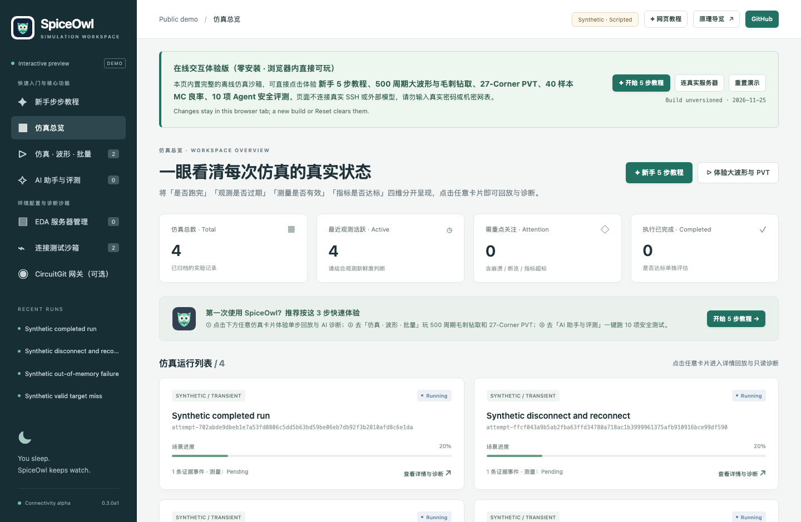

# Local console

SpiceOwl 0.3.0a1 is a single-user alpha for macOS and Linux with Python 3.11 or newer. It provides a simulation engine SDK, browser console and CLI backed by the same SQLite records. The core uses Python's standard library; browser assets ship in the package and do not require Node.js. AI interaction uses [CircuitGit's existing Codex window](native-agent.md). Engine imports and read-only views do not require the optional MCP compatibility dependency.

The console has separate **synthetic demo runs** and an optional **real standalone Spectre view**. Start with `serve --live-client-config PRIVATE_CONFIG` to use the shared client for CircuitGit’s existing Runner, explicit resource scans, submission, status, collection and background watches. The [standalone runtime guide](standalone-runtime.md) covers private grants, exact identities and limits. The console manages simulation evidence and preserves earlier Q&A history; new AI conversations and model settings belong in CircuitGit. Automatic solver restart and parameter repair remain unimplemented. The HTTP server is intended for alpha use on loopback, not public or shared production hosting.

A separate, explicitly authorized [developer inverter smoke utility](../examples/inverter/README.md) can execute the original MOS1 example on licensed Spectre. The [IC Workbench integration](ic-workbench.md) reads stored native records into a separate passive cache; IC Workbench retains submission and approval ownership. The real-client panel is configured separately; demo runs always retain their synthetic identity.



The screenshot is from the working browser interface with manually advanced demo scenarios. It contains no real circuit or simulator output.

## Install from source

From the repository root, using Python 3.11+:

```bash
python3 -m venv .venv
.venv/bin/python -m pip install .
.venv/bin/spiceowl serve --demo
```

Open the loopback URL printed by the command, normally `http://127.0.0.1:8765`. `--demo` creates two offline connections and four synthetic runs. Repeating it preserves existing data and replay progress. Omitting `--demo` starts with an empty workspace and a Load demo button.

Source development without installing:

```bash
PYTHONPATH=src python3 -m spiceowl --data-dir .spiceowl serve --demo
```

`--data-dir` is a global option and goes before the subcommand. The default is `$XDG_STATE_HOME/spiceowl`, or `~/.local/state/spiceowl` when that variable is unset. Keep this SQLite directory on local storage. Port selection uses `serve --port 8766`; the bind address is always `127.0.0.1`.

## Browser workflow

1. Load the demo workspace. Its run cards and charts represent authored synthetic observations; real host checks and the optional real-simulation panel have separate views.
2. Open Connections. Add a fake agent or model API and choose success, denied inference, interrupted response, or denied tool request. Probe metadata to see transport/auth/catalog separately from inference verification.
3. Open a run. Select Next observation to advance its finite scenario. Disconnect preserves the same execution identity; OOM records failure; target miss ends with valid measurement and failed specification.
4. Ask the demo diagnostic assistant about the current snapshot. Its response is deterministic fixture output, not an LLM. Inspect stored events, evidence citations and an advisory policy decision.
5. Refresh the page or restart the service to inspect the same run and session history. Display reconnection does not start another diagnosis. An interrupted accepted turn is marked `outcome_unknown` and is never automatically replayed.
6. Use Simulation hosts → Add host or Import pool to register a private profile or preview an explicit pool; the CLI remains available. Then explicitly check connections/resources and evaluate requested CPU/memory. [Host onboarding](host-onboarding.md) explains the fields and separate diagnostic states. Results are timestamped; there is no automatic remote polling. Execution plans preserve standalone versus Virtuoso-native ownership and do not launch jobs.
7. Use CircuitGit's existing Codex/AI window for a real agent conversation. The console's AI page explains that route and lets you inspect historical SpiceOwl Q&A; it does not start another native question or readiness probe.

In the synthetic diagnosis workflow, read-only suggestions can receive an allow decision, but **diagnostic action dispatch remains disabled**. There is no Execute fix button. Cancelling a diagnosis only stops that local fake turn; it does not change the run.

An unresolved turn blocks another diagnosis on its connection or run. This prototype offers inspection, not a pretend reconciliation of an unknown provider operation. Explore another run/connection or a separate demo state directory to test an independent scenario. Production resolution workflows belong to the real-provider milestone.

## CLI

Read-only commands work while the web controller is running:

```bash
spiceowl --data-dir /home/example/state/spiceowl read status
spiceowl --data-dir /home/example/state/spiceowl read connections
spiceowl --data-dir /home/example/state/spiceowl read hosts
spiceowl --data-dir /home/example/state/spiceowl read runs
spiceowl --data-dir /home/example/state/spiceowl read run RUN_ID
```

These examples require the console's already existing SpiceOwl state. They are optional stored-data access, not a new database or connection required by CircuitGit. CircuitGit's own Runner/Supervision records remain a separate dataset.

Host registration/probes, the `read` CLI and read-only SDK queries, and `live` CLI operations also work alongside the web controller. Point CLI and web at the same private live-client configuration to share their request journal. For the standalone synthetic mutation workflow below, stop the web controller first. Only one controller can own a state directory; this prevents one process from declaring another process's active turn interrupted.

```bash
spiceowl demo
spiceowl connections add --label "My fake agent" --kind agent
spiceowl connections probe demo-agent --level models
spiceowl runs advance demo-disconnect
spiceowl diagnose demo-disconnect --connection demo-agent --request-key demo-question-1
```

The final command prints the persisted session. Repeating the same request key and identical input returns the original turn; changed input with that key is rejected. Keys are globally unique within the prototype state directory. Connection disable/removal affects future dispatch; historical records remain readable.

## What is durable

SQLite stores connection metadata, private host profiles and their last probes, synthetic run snapshots, frozen diagnostic evidence, requests, turns, ordered events, proposals and policy decisions. A transaction claims a unique request key before starting work. One active or unresolved turn per connection/run prevents competing diagnosis. Event display uses a persistent cursor; identical text is not used as a deduplication key. Browser forms do not accept credentials or provider secrets; SSH authentication stays in OpenSSH configuration. The optional live connection loads its operator-provisioned private HMAC key from the server-side startup configuration, never from a browser request.

Earlier native Q&A records remain readable through the historical view and `questions list` / `questions inspect QA_ID`. They are not migrated into a new AI conversation or resent. CircuitGit owns the current AI session lifecycle.

Shutting down the SpiceOwl HTTP interface does not erase data or cancel a remote simulation. Synthetic run advancement is still explicit replay. Real observation runs inside the CircuitGit service using SpiceOwl’s shared monitor, so that service must stay running and connected overnight. Watch recovery after gateway restart is explicit by default, with operator-configured authorized resumption available. Watches do not automatically collect or restart simulations; see [monitor lifecycle](standalone-runtime.md#keeping-watch-overnight).

## Local HTTP boundary

The console checks loopback Host and Origin, requires an unpredictable token for writes, limits JSON request size, rejects duplicate keys and nonfinite numbers, and serves only named packaged assets. It never serves arbitrary paths or accepts shell commands. Scripts/fonts/assets are local; no analytics or third-party CDN is used. These controls do not make a shared computer or public deployment a supported security boundary. No user authentication, TLS termination, multi-user isolation, or network exposure is provided.

The API is an alpha implementation interface: the original demo is documented in [P0.1 contracts](contracts/p01-runtime.md), while the optional real client is documented in [standalone runtime](standalone-runtime.md). It is not a stable external integration API yet.

## Verification

```bash
PYTHONPATH=src python3 -m unittest discover -s tests
git diff --check
```

Tests use temporary local state and loopback HTTP; no API keys, model subscriptions, PDK or commercial simulator is required. They cover contract validation, replay identity, valid specification failures, request deduplication, cancellation scope, interrupted-turn recovery, browser API boundaries and event persistence. Fake/synthetic tests do not establish real provider or Spectre support.
