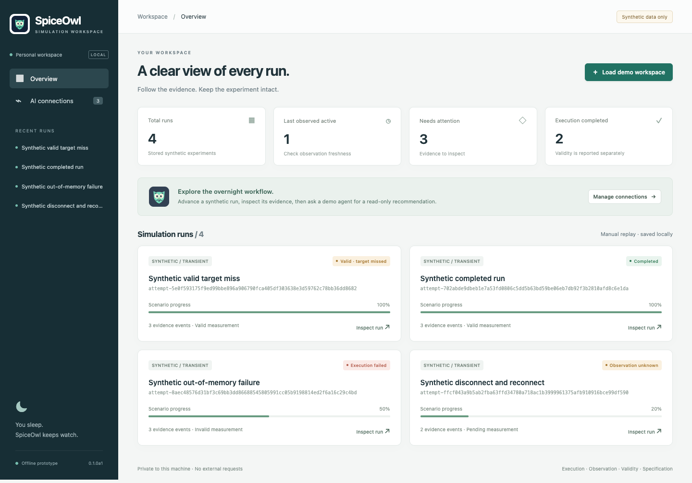

# Local console: first runnable prototype

SpiceOwl 0.1.0a1 is an offline, single-user prototype for macOS and Linux with Python 3.11 or newer. It provides a browser console and CLI backed by the same SQLite records. Runtime dependencies are Python's standard library; the package contains its browser assets and does not require Node.js.

This build uses **synthetic data only**. It does not authenticate to providers, call models, connect to Cadence, submit jobs, or resume a real solver. Its local HTTP server is intended for prototype use on loopback, not public or shared production hosting.



The screenshot is from the working browser interface with manually advanced demo scenarios. It contains no real circuit or simulator output.

## Install from source

From the repository root, using Python 3.11+:

```bash
python3 -m venv .venv
.venv/bin/python -m pip install .
.venv/bin/spiceowl serve --demo
```

Open the loopback URL printed by the command, normally `http://127.0.0.1:8765`. `--demo` creates two offline connections and four synthetic runs. Repeating it preserves existing data and replay progress. Omitting `--demo` starts with an empty workspace and a Load demo button.

Source development without installing:

```bash
PYTHONPATH=src python3 -m spiceowl --data-dir .spiceowl serve --demo
```

`--data-dir` is a global option and goes before the subcommand. The default is `$XDG_STATE_HOME/spiceowl`, or `~/.local/state/spiceowl` when that variable is unset. Keep this SQLite directory on local storage. Port selection uses `serve --port 8766`; the bind address is always `127.0.0.1`.

## Browser workflow

1. Load the demo workspace. Every card and chart represents authored synthetic observations.
2. Open Connections. Add a fake agent or model API and choose success, denied inference, interrupted response, or denied tool request. Probe metadata to see transport/auth/catalog separately from inference verification.
3. Open a run. Select Next observation to advance its finite scenario. Disconnect preserves the same execution identity; OOM records failure; target miss ends with valid measurement and failed specification.
4. Ask the demo diagnostic assistant about the current snapshot. Its response is deterministic fixture output, not an LLM. Inspect stored events, evidence citations and an advisory policy decision.
5. Refresh the page or restart the service to inspect the same run and session history. Display reconnection does not start another diagnosis. An interrupted accepted turn is marked `outcome_unknown` and is never automatically replayed.

Read-only suggestions can receive an allow decision, but **dispatch remains disabled**. There is no Execute fix button. Cancelling a diagnosis only stops that local fake turn; it does not change the run.

An unresolved turn blocks another diagnosis on its connection or run. This prototype offers inspection, not a pretend reconciliation of an unknown provider operation. Explore another run/connection or a separate demo state directory to test an independent scenario. Production resolution workflows belong to the real-provider milestone.

## CLI

Read-only commands work while the web controller is running:

```bash
spiceowl status
spiceowl connections list
spiceowl connections inspect demo-agent
spiceowl runs list
spiceowl session SESSION_ID --after 0
```

For the standalone CLI workflow, stop the web controller first. Only one controller can own a state directory; this prevents one process from declaring another process's active turn interrupted.

```bash
spiceowl demo
spiceowl connections add --label "My fake agent" --kind agent
spiceowl connections probe demo-agent --level models
spiceowl runs advance demo-disconnect
spiceowl diagnose demo-disconnect --connection demo-agent --request-key demo-question-1
```

The final command prints the persisted session. Repeating the same request key and identical input returns the original turn; changed input with that key is rejected. Keys are globally unique within the prototype state directory. Connection disable/removal affects future dispatch; historical records remain readable.

## What is durable

SQLite stores connection metadata, synthetic run snapshots, frozen diagnostic evidence, requests, turns, ordered events, proposals and policy decisions. A transaction claims a unique request key before starting work. One active or unresolved turn per connection/run prevents competing diagnosis. Event display uses a persistent cursor; identical text is not used as a deduplication key. Source credentials and provider secrets are not accepted by this build.

Shutting down the HTTP interface does not erase data. This prototype does not implement a real background simulation monitor: run advancement is explicit replay. Future deployment of real monitoring/execution on an always-on host remains required for unattended simulations.

## Local HTTP boundary

The console checks loopback Host and Origin, requires an unpredictable token for writes, limits JSON request size, rejects duplicate keys and nonfinite numbers, and serves only named packaged assets. It never serves arbitrary paths or accepts shell commands. Scripts/fonts/assets are local; no analytics or third-party CDN is used. These controls do not make a shared computer or public deployment a supported security boundary. No user authentication, TLS termination, multi-user isolation, or network exposure is provided.

The API is an alpha implementation interface, documented in [P0.1 contracts](contracts/p01-runtime.md). It is not a stable external integration API yet.

## Verification

```bash
PYTHONPATH=src python3 -m unittest discover -s tests
git diff --check
```

Tests use temporary local state and loopback HTTP; no API keys, model subscriptions, PDK or commercial simulator is required. They cover contract validation, replay identity, valid specification failures, request deduplication, cancellation scope, interrupted-turn recovery, browser API boundaries and event persistence. Fake/synthetic tests do not establish real provider or Spectre support.
